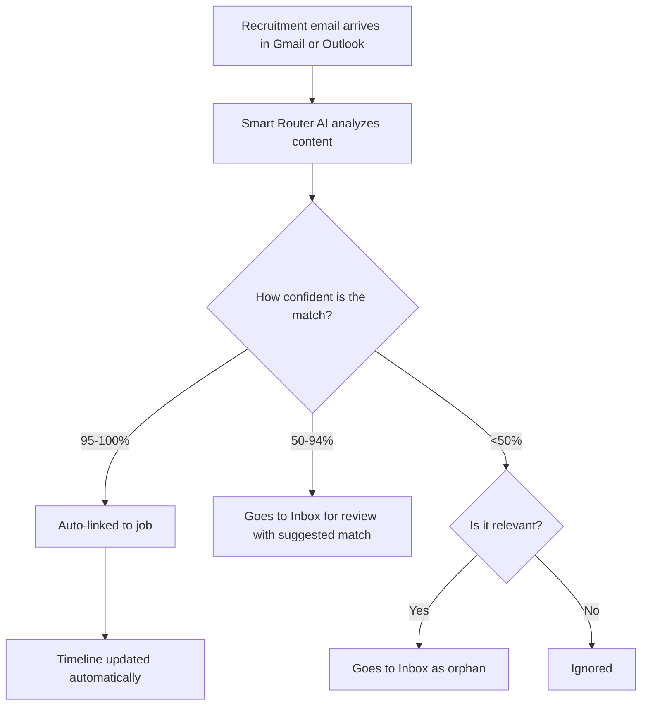

## What it is

The Tracking Inbox monitors Gmail or Outlook (Microsoft Graph) for job-application responses and updates timelines. After a resume is tailored, it can also prepare an application email to a tracked recruiter for your review and explicit confirmation.


### Overview

1. Scans Gmail or Outlook for recruitment-related emails
2. Matches emails to tracked jobs using AI
3. Updates timeline/state when confidence is high
4. Queues uncertain matches for manual review
5. Prepares a recruiter email with a generated cover letter and the tailored PDF, sent only after you confirm

## Why it exists

Application replies and recruiter outreach arrive by email, and manually copying every detail into the job timeline is repetitive. Automatic matching keeps the timeline current, while the review queue keeps uncertain matches out of your records. The recruiter-email action closes the loop: once a resume is tailored, you can respond from the same job record with the correct PDF attached, without giving up control of what is sent.

## How to use it

### Smart router flow



### Setup

#### Prerequisites

1. Gmail account with application emails, or an Outlook mailbox to track via Microsoft Graph
2. Provider OAuth credentials (Google, or a Microsoft Entra app registration)

#### Configure OAuth

Microsoft Graph is the default provider. Register a Microsoft Entra app and set:

```bash
GRAPH_OAUTH_CLIENT_ID=your-application-client-id
GRAPH_OAUTH_CLIENT_SECRET=your-client-secret
GRAPH_OAUTH_TENANT_ID=common
GRAPH_OAUTH_REDIRECT_URI=https://your-domain.com/oauth/graph/callback
```

Then connect in UI via **Tracking Inbox → Connect**. The provider selector is preselected to `Microsoft Graph`.

To use Gmail instead, set `GMAIL_OAUTH_CLIENT_ID`, `GMAIL_OAUTH_CLIENT_SECRET`, and `GMAIL_OAUTH_REDIRECT_URI`, select `Gmail` in the provider selector, then click **Connect**.

Detailed setup guides:

- [Gmail OAuth Setup](/docs/next/getting-started/gmail-oauth-setup)
- [Microsoft Graph OAuth Setup](/docs/next/getting-started/microsoft-graph-oauth-setup)

### Using the inbox

- Review pending items in Tracking Inbox
- Approve to link/update timeline
- Ignore to mark non-relevant

### Check the connection

Select a connected provider in **Tracking Inbox** and click **View last email**
next to **Sync**. JobOps reads the single newest message directly from the
mailbox and shows its sender, subject, received time, and preview. This proves
the stored OAuth credentials can still reach the account, independently of sync
results and classification.

The check is read-only: nothing is sent, moved, or deleted. An empty mailbox
shows "no messages". The diagnostic supports Gmail and Microsoft Graph; IMAP is
not supported.

### Job emails tab

Open **Job → Emails** to review captured messages already linked to that job.

The tab is read-only. It shows stored metadata only: sender, subject, received
time, snippet, processing status, message type, match confidence, account label,
and a Gmail thread link when the stored message includes a Gmail thread ID.

It does not store full email bodies, re-fetch from Gmail, or expose review
actions. Use **Tracking Inbox** for approve/ignore decisions.

Confidence interpretation:

- `95-100%`: auto-processed
- `50-94%`: pending review with suggestion
- `<50%`: pending review as orphan/ignored

### Email a recruiter

On a job with a generated tailored PDF, open the **Apply** tab and click **Apply now** (or use **Email recruiter** in the **More actions** menu). JobOps generates a cover letter from the job and tailored CV, then shows a preview you can edit:

- **To**: defaults to the `From` address of a matched Tracking Inbox email. If no email is matched, JobOps uses the first valid address from the job's `emails` field and then its job description. The preview labels addresses taken from job details so you can verify them. Editable, but only a single plain email address is accepted. No BCC is added.
- **Cover letter**: editable. Changing it updates the **Message** below automatically.
- **Subject** and **Message**: editable; the generated cover letter plus a short sign-off is the initial message and is sent as plain text.
- **Preview PDF**: opens the tailored PDF in a popup dialog on the current page.
- **Attachment**: the tailored PDF already generated for that job. Files over 4 MB are rejected.

Nothing is sent when the preview is generated. The send button stays disabled until you check the confirmation box and click **Send email**. Preview tokens expire after 10 minutes by default, are single-use, and are scoped to the signed-in user and workspace. Sending requires Microsoft Graph with delegated `Mail.Send` granted and consented; see [Microsoft Graph OAuth Setup](/docs/next/getting-started/microsoft-graph-oauth-setup).

For a job whose details could not be fetched, add the recruiter address to the job description before opening **Apply now**. JobOps pre-fills it, but job-post text is untrusted: always verify the **To** field before confirming. If no address is found in the Tracking Inbox, the job's `emails` field, or the description, the preview explains where to add one.

```bash
# Preview (no side effects)
curl -X POST "http://localhost:3001/api/jobs/<jobId>/email/preview" \
  -H "content-type: application/json" \
  -d '{"messageId":"<matchedMessageId>"}'

# Confirm and send
curl -X POST "http://localhost:3001/api/jobs/<jobId>/email/send" \
  -H "content-type: application/json" \
  -d '{"previewToken":"<previewToken>","to":"recruiter@example.com","subject":"Application","body":"..."}'
```

There is no auto-send, bulk send, or scheduled send in this version.

### Manual application documents

If the job post has no recruiter email, you can still use the generated materials:

- The **Download PDF** action saves the tailored CV as `Mohamed Mseddi Resume {CompanyName}.pdf` (for example, `Mohamed Mseddi Resume Dwareapps.pdf`). The same filename is used for the email attachment when applying through JobOps.
- The **Cover letter** button (Apply tab) and **Cover letter** button (job page sidebar) open a letter drafted from the job description and tailored resume. Opening the dialog only loads the saved copy; it never calls the AI. Click **Generate** (or **Regenerate**) to create a fresh draft. Review or edit the text, then click **Save** to persist your changes for that job. Choose **Download .txt** to save `Mohamed Mseddi Cover Letter {CompanyName}.txt` or **Download .pdf** to save `Mohamed Mseddi Cover Letter {CompanyName}.pdf`. Both downloads use the text currently in the editor and the same company name as the tailored CV. A saved letter is also reused by the recruiter-email preview.

No email is required or sent when generating, saving, or downloading these files.

```bash
# Generate a cover letter only (no email is sent); the result is saved
curl -X POST "http://localhost:3001/api/jobs/<jobId>/cover-letter" \
  -H "content-type: application/json" \
  -d '{}'

# Save edited text without calling the AI
curl -X PUT "http://localhost:3001/api/jobs/<jobId>/cover-letter" \
  -H "content-type: application/json" \
  -d '{"coverLetter":"Dear hiring team, ..."}'
```

## Privacy and security

- Gmail scope requested: `gmail.readonly` (`https://www.googleapis.com/auth/gmail.readonly`)
- Microsoft Graph scopes: `openid`, `offline_access`, `User.Read`, `Mail.Read`, and `Mail.Send` (only for sending after confirmation)
- Minimal profile and job fields are sent to the LLM for matching and cover-letter generation
- Email data stays local in your instance
- Graph send uses a single `fileAttachment`, no BCC, and `saveToSentItems: true`; upstream error bodies are never logged or returned

## API reference

| Method | Endpoint                                  | Description           |
| ------ | ----------------------------------------- | --------------------- |
| GET    | `/api/post-application/inbox`             | List pending messages |
| POST   | `/api/post-application/inbox/:id/approve` | Approve message       |
| POST   | `/api/post-application/inbox/:id/deny`    | Ignore message        |
| GET    | `/api/post-application/runs`              | List sync runs        |
| POST   | `/api/post-application/providers/:provider/last-message` | Read newest message for connection testing |
| GET    | `/api/jobs/:id/emails?limit=100`          | List job-linked email metadata |
| GET    | `/api/post-application/providers/gmail/oauth/start` | Start OAuth flow |
| POST   | `/api/post-application/providers/gmail/oauth/exchange` | Exchange OAuth code |
| POST   | `/api/jobs/:id/email/preview`         | Preview a recruiter email (no send) |
| POST   | `/api/jobs/:id/email/send`            | Confirm and send a previewed email |
| POST   | `/api/jobs/:id/cover-letter`          | Generate and save a cover letter  |
| PUT    | `/api/jobs/:id/cover-letter`          | Save edited cover letter text     |

## Common problems

- No refresh token: disconnect and reconnect the provider.
- Emails not appearing: check runs, OAuth config, and recruitment subjects.
- Wrong matches: expected in lower-confidence buckets; use manual review.
- "Reconnect Microsoft Graph to grant Mail.Send permission": `Mail.Send` was added after the Graph connection was authorized; disconnect, reconnect, and approve the permission.
- "Apply now" / "Email recruiter" disabled: tailor and generate the PDF for that job first.
- "No recruitment email is linked... no address was found in its details": add the recruiter address to the job description or link a tracked email in the Tracking Inbox.
- Wrong recipient pre-filled from job details: edit the **To** field in the preview; only your explicit confirmation sends the email.
- Preview token expired or already used: open **Apply now** again to generate a fresh preview.

## Related pages

- [Microsoft Graph OAuth Setup](/docs/next/getting-started/microsoft-graph-oauth-setup)
- [Gmail OAuth Setup](/docs/next/getting-started/gmail-oauth-setup)
- [Post-Application Workflow](/docs/next/workflows/post-application-workflow)
- [In Progress Board](/docs/next/features/in-progress-board)
