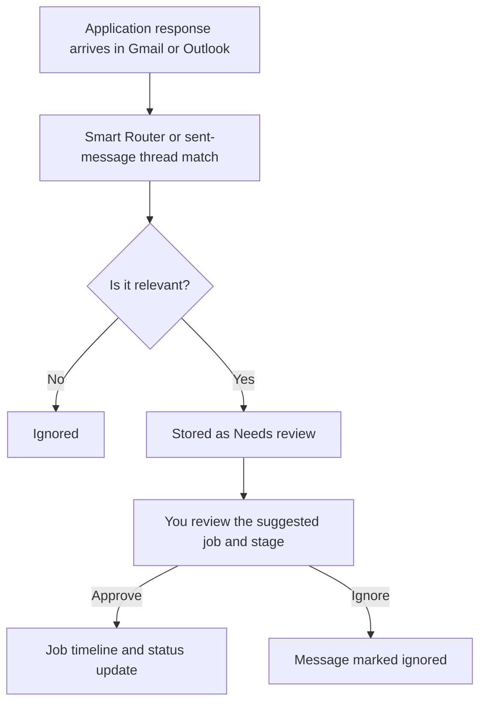

# Application Response Tracking Implementation Plan

> **For Claude:** REQUIRED SUB-SKILL: Use godmode:task-runner to implement this plan task-by-task.

**Goal:** Add a tenant-aware 30-minute Gmail/Microsoft Graph background sync that queues every detected application response for explicit approval, persists Graph send/thread identifiers, and surfaces pending responses on the job page and Tracking Inbox.

**Architecture:** Extend the existing Tracking Inbox ingestion and review pipeline rather than creating a new inbox. A scheduler enumerates connected integrations without request scope, then runs each account sync inside `runWithRequestContext()` using that integration row's `tenantId`, `userId`, and a generated request ID; all normal repository scope filters apply. Ingestion never calls `transitionStage()`—only the existing approval path does.

**Tech Stack:** TypeScript, Node.js 22, Express, Drizzle ORM + SQLite/better-sqlite3, Microsoft Graph REST API, Gmail API, React + TanStack Query + Testing Library, Vitest, Biome, Docusaurus.

---

## Execution rules for the implementer

- Use `godmode:test-first` for every task below: failing test → observe failure → minimal implementation → passing test → commit.
- Run commands from the repository root `C:\Users\msedd\job-ops` unless a command says otherwise.
- Do not push to `origin/main`. The only allowed final push target is `fork/main`.
- Preserve the existing API response envelope `{ ok, data/error, meta.requestId }`; this plan adds no new API route.
- Use `infra/logger.ts` for all new server logging. Never log raw email bodies, subjects, addresses, OAuth credentials, Graph/Gmail error bodies, or large `JSON.stringify()` blobs.
- Treat every server-side change as multi-tenant by default. The scheduler is the only intentional global reader, and it immediately re-establishes per-tenant context for each sync.

---

### Task 1: Data model and sent-email provenance repository

**Files:**
- Create: `orchestrator/src/server/repositories/post-application-sent-emails.test.ts`
- Modify: `shared/src/types/recruiter-email.ts:50-66`
- Modify: `orchestrator/src/server/db/schema.ts:1099-1138`
- Modify: `orchestrator/src/server/db/migrate.ts:812-834`
- Modify: `orchestrator/src/server/db/migrate.ts:1357-1387`
- Modify: `orchestrator/src/server/repositories/post-application-sent-emails.ts:1-111`

**Step 1: Write the failing test**

Create `orchestrator/src/server/repositories/post-application-sent-emails.test.ts` with this complete content:

```ts
import { mkdtemp, rm } from "node:fs/promises";
import { tmpdir } from "node:os";
import { join } from "node:path";
import Database from "better-sqlite3";
import { afterEach, beforeEach, describe, expect, it, vi } from "vitest";

type RequestContextModule = typeof import("@infra/request-context");

const scopeA = { requestId: "test-a", tenantId: "tenant-a", userId: "user-a" };
const scopeB = { requestId: "test-b", tenantId: "tenant-b", userId: "user-b" };

describe.sequential("post-application sent-email provenance", () => {
  let tempDir: string;
  let db: Awaited<typeof import("../db/index")>["db"];
  let schema: Awaited<typeof import("../db/index")>["schema"];
  let repo: Awaited<typeof import("./post-application-sent-emails")>;
  let runWithRequestContext: RequestContextModule["runWithRequestContext"];

  beforeEach(async () => {
    vi.resetModules();
    tempDir = await mkdtemp(join(tmpdir(), "job-ops-sent-email-provenance-"));
    process.env.DATA_DIR = tempDir;
    process.env.NODE_ENV = "test";

    await import("../db/migrate");
    ({ db, schema } = await import("../db/index"));

    await db.insert(schema.tenants).values([
      { id: "tenant-a", name: "Tenant A", slug: "tenant-a" },
      { id: "tenant-b", name: "Tenant B", slug: "tenant-b" },
    ]);
    await db.insert(schema.users).values([
      { id: "user-a", username: "user-a" },
      { id: "user-b", username: "user-b" },
    ]);
    await db.insert(schema.jobs).values([
      {
        id: "job-a",
        tenantId: "tenant-a",
        source: "manual",
        title: "Engineer A",
        employer: "Acme A",
        jobUrl: "https://example.test/job-a",
      },
      {
        id: "job-b",
        tenantId: "tenant-b",
        source: "manual",
        title: "Engineer B",
        employer: "Acme B",
        jobUrl: "https://example.test/job-b",
      },
    ]);

    repo = await import("./post-application-sent-emails");
    ({ runWithRequestContext } = await import("@infra/request-context"));
  });

  afterEach(async () => {
    const { closeDb } = await import("../db/index");
    closeDb();
    await rm(tempDir, { recursive: true, force: true });
    vi.clearAllMocks();
  });

  it("adds nullable legacy columns and scopes provenance reads and writes", async () => {
    const raw = new Database(join(tempDir, "jobs.db"));
    const columns = raw
      .prepare("PRAGMA table_info(post_application_sent_emails)")
      .all() as Array<{ name: string }>;
    raw.close();

    expect(columns.map((column) => column.name)).toContain("graph_message_id");
    expect(columns.map((column) => column.name)).toContain(
      "internet_message_id",
    );

    const a = await runWithRequestContext(scopeA, () =>
      repo.createPostApplicationSentEmail({
        jobId: "job-a",
        integrationId: null,
        provider: "graph",
        toAddress: "recruiter-a@example.com",
        subject: "Application A",
        messageId: "tracked-msg-a",
        status: "sent",
        sentAt: 1_700_000_000_000,
        graphMessageId: "graph-message-a",
        internetMessageId: "<message-a@example.com>",
      }),
    );
    const b = await runWithRequestContext(scopeB, () =>
      repo.createPostApplicationSentEmail({
        jobId: "job-b",
        integrationId: null,
        provider: "graph",
        toAddress: "recruiter-b@example.com",
        subject: "Application B",
        messageId: "tracked-msg-b",
        status: "sent",
        sentAt: 1_700_000_100_000,
        graphMessageId: "graph-message-a",
        internetMessageId: "<message-a@example.com>",
      }),
    );

    expect(a).toMatchObject({
      graphMessageId: "graph-message-a",
      internetMessageId: "<message-a@example.com>",
    });
    expect(b).toMatchObject({
      graphMessageId: "graph-message-a",
      internetMessageId: "<message-a@example.com>",
    });

    const updatedA = await runWithRequestContext(scopeA, () =>
      repo.updatePostApplicationSentEmailProvenance({
        id: a.id,
        graphMessageId: "graph-message-a-updated",
        internetMessageId: "<message-a-updated@example.com>",
      }),
    );
    expect(updatedA).toMatchObject({
      id: a.id,
      graphMessageId: "graph-message-a-updated",
      internetMessageId: "<message-a-updated@example.com>",
    });

    const blockedUpdate = await runWithRequestContext(scopeB, () =>
      repo.updatePostApplicationSentEmailProvenance({
        id: a.id,
        graphMessageId: "cross-tenant-write",
        internetMessageId: "<cross-tenant@example.com>",
      }),
    );
    expect(blockedUpdate).toBeNull();

    const threadA = await runWithRequestContext(scopeA, () =>
      repo.findPostApplicationSentEmailByThread({
        provider: "graph",
        internetMessageId: "<other@example.com>",
        inReplyTo: ["<message-a-updated@example.com>"],
        references: [],
        graphConversationId: null,
      }),
    );
    expect(threadA?.id).toBe(a.id);

    const threadB = await runWithRequestContext(scopeB, () =>
      repo.findPostApplicationSentEmailByThread({
        provider: "graph",
        internetMessageId: null,
        inReplyTo: ["<message-a-updated@example.com>"],
        references: [],
        graphConversationId: null,
      }),
    );
    expect(threadB?.id).toBe(b.id);

    const unchangedB = await runWithRequestContext(scopeB, () =>
      repo.listPostApplicationSentEmailsForJob("job-b", 10),
    );
    expect(unchangedB[0]).toMatchObject({
      graphMessageId: "graph-message-a",
      internetMessageId: "<message-a@example.com>",
    });
  });
});
```

**Step 2: Run the test to verify failure**

Run:

```bash
npm --workspace orchestrator run test:run -- src/server/repositories/post-application-sent-emails.test.ts
```

Expected: FAIL with module export errors such as `createPostApplicationSentEmail(...): 'graphMessageId' does not exist in type 'CreateSentEmailInput'` and `updatePostApplicationSentEmailProvenance is not a function`.

**Step 3: Add the shared type fields**

In `shared/src/types/recruiter-email.ts`, replace:

```ts
  messageId: string | null;
  status: PostApplicationSentEmailStatus;
```

with:

```ts
  messageId: string | null;
  /** Graph message id returned when the recruiter-email draft was created. */
  graphMessageId: string | null;
  /** RFC 5322 internetMessageId returned by Graph for the sent message. */
  internetMessageId: string | null;
  status: PostApplicationSentEmailStatus;
```

**Step 4: Add the schema columns and indexes**

In `orchestrator/src/server/db/schema.ts`, replace the `messageId` line and the index block inside `postApplicationSentEmails` with:

```ts
    messageId: text("message_id"),
    graphMessageId: text("graph_message_id"),
    internetMessageId: text("internet_message_id"),
    status: text("status", { enum: POST_APPLICATION_SENT_EMAIL_STATUSES })
      .notNull()
      .default("sent"),
```

```ts
  (table) => ({
    jobIndex: index("idx_post_app_sent_emails_job_id").on(table.jobId),
    tenantUserJobIndex: index("idx_post_app_sent_emails_tenant_user_job").on(
      table.tenantId,
      table.userId,
      table.jobId,
    ),
    internetMessageIdIndex: index(
      "idx_post_app_sent_emails_provider_internet_message_id",
    ).on(table.provider, table.internetMessageId),
    graphMessageIdIndex: index(
      "idx_post_app_sent_emails_provider_graph_message_id",
    ).on(table.provider, table.graphMessageId),
  }),
```

**Step 5: Add migration statements with legacy safety**

In `orchestrator/src/server/db/migrate.ts`, replace the `post_application_sent_emails` `CREATE TABLE` statement with:

```ts
  `CREATE TABLE IF NOT EXISTS post_application_sent_emails (
    id TEXT PRIMARY KEY,
    tenant_id TEXT NOT NULL DEFAULT 'tenant_default',
    user_id TEXT,
    job_id TEXT NOT NULL,
    integration_id TEXT,
    provider TEXT NOT NULL CHECK(provider IN ('gmail', 'imap', 'graph')),
    to_address TEXT NOT NULL,
    subject TEXT NOT NULL,
    message_id TEXT,
    graph_message_id TEXT,
    internet_message_id TEXT,
    status TEXT NOT NULL DEFAULT 'sent' CHECK(status IN ('sent', 'failed')),
    error_code TEXT,
    error_message TEXT,
    sent_at INTEGER,
    created_at TEXT NOT NULL DEFAULT (datetime('now')),
    updated_at TEXT NOT NULL DEFAULT (datetime('now')),
    FOREIGN KEY (tenant_id) REFERENCES tenants(id) ON DELETE CASCADE,
    FOREIGN KEY (job_id) REFERENCES jobs(id) ON DELETE CASCADE,
    FOREIGN KEY (integration_id) REFERENCES post_application_integrations(id) ON DELETE SET NULL
  )`,
```

Immediately after the existing `idx_post_app_sent_emails_job_id` index statement, add:

```ts
  `ALTER TABLE post_application_sent_emails ADD COLUMN graph_message_id TEXT`,
  `ALTER TABLE post_application_sent_emails ADD COLUMN internet_message_id TEXT`,
  `CREATE INDEX IF NOT EXISTS idx_post_app_sent_emails_provider_internet_message_id
    ON post_application_sent_emails(provider, internet_message_id)`,
  `CREATE INDEX IF NOT EXISTS idx_post_app_sent_emails_provider_graph_message_id
    ON post_application_sent_emails(provider, graph_message_id)`,
```

In the duplicate-column allowlist at `migrate.ts:1363-1386`, add this condition before the `analytics_install_state` condition:

```ts
        migration
          .toLowerCase()
          .includes("alter table post_application_sent_emails add column") ||
```

The resulting tail of the allowlist must be:

```ts
        migration
          .toLowerCase()
          .includes("alter table job_chat_threads add column") ||
        migration
          .toLowerCase()
          .includes("alter table analytics_install_state add column")) &&
      message.toLowerCase().includes("duplicate column name");
```

becomes:

```ts
        migration
          .toLowerCase()
          .includes("alter table job_chat_threads add column") ||
        migration
          .toLowerCase()
          .includes("alter table post_application_sent_emails add column") ||
        migration
          .toLowerCase()
          .includes("alter table analytics_install_state add column")) &&
      message.toLowerCase().includes("duplicate column name");
```

**Step 6: Implement the repository changes**

In `orchestrator/src/server/repositories/post-application-sent-emails.ts`, replace the imports and the whole file body with this complete content:

```ts
import { randomUUID } from "node:crypto";
import type {
  PostApplicationProvider,
  PostApplicationSentEmail,
  PostApplicationSentEmailStatus,
} from "@shared/types";
import { and, desc, eq, inArray, or, type SQL } from "drizzle-orm";
import { db, schema } from "../db";
import {
  getPrivateDataScope,
  privateDataScopeFilter,
} from "../tenancy/private-scope";

const { postApplicationSentEmails } = schema;

export type CreateSentEmailInput = {
  jobId: string;
  integrationId: string | null;
  provider: PostApplicationProvider;
  toAddress: string;
  subject: string;
  messageId: string | null;
  status: PostApplicationSentEmailStatus;
  errorCode?: string | null;
  errorMessage?: string | null;
  sentAt: number | null;
  graphMessageId?: string | null;
  internetMessageId?: string | null;
};

export type UpdateSentEmailProvenanceInput = {
  id: string;
  graphMessageId: string | null;
  internetMessageId: string | null;
};

export type FindSentEmailByThreadInput = {
  provider: PostApplicationProvider;
  internetMessageId: string | null;
  inReplyTo: string[];
  references: string[];
  graphConversationId: string | null;
};

function normalizeInternetMessageId(value: string): string | null {
  const normalized = value.trim().replace(/^<|>$/g, "").toLowerCase();
  return normalized.length > 0 ? normalized : null;
}

function collectInternetMessageIds(values: Array<string | null>): string[] {
  const ids = values
    .map((value) => (typeof value === "string" ? normalizeInternetMessageId(value) : null))
    .filter((value): value is string => Boolean(value));
  return Array.from(new Set(ids));
}

function mapRow(
  row: typeof postApplicationSentEmails.$inferSelect,
): PostApplicationSentEmail {
  return {
    id: row.id,
    tenantId: row.tenantId,
    userId: row.userId,
    jobId: row.jobId,
    integrationId: row.integrationId,
    provider: row.provider as PostApplicationProvider,
    toAddress: row.toAddress,
    subject: row.subject,
    messageId: row.messageId,
    graphMessageId: row.graphMessageId,
    internetMessageId: row.internetMessageId,
    status: row.status as PostApplicationSentEmailStatus,
    errorCode: row.errorCode,
    errorMessage: row.errorMessage,
    sentAt: row.sentAt,
    createdAt: row.createdAt,
    updatedAt: row.updatedAt,
  };
}

export async function createPostApplicationSentEmail(
  input: CreateSentEmailInput,
): Promise<PostApplicationSentEmail> {
  const scope = getPrivateDataScope();
  const id = randomUUID();
  const nowIso = new Date().toISOString();
  const values = {
    id,
    tenantId: scope.tenantId,
    userId: scope.userId,
    jobId: input.jobId,
    integrationId: input.integrationId,
    provider: input.provider,
    toAddress: input.toAddress,
    subject: input.subject,
    messageId: input.messageId,
    graphMessageId: input.graphMessageId ?? null,
    internetMessageId: input.internetMessageId ?? null,
    status: input.status,
    errorCode: input.errorCode ?? null,
    errorMessage: input.errorMessage ?? null,
    sentAt: input.sentAt,
    createdAt: nowIso,
    updatedAt: nowIso,
  };
  await db.insert(postApplicationSentEmails).values(values);
  return mapRow(values);
}

export async function updatePostApplicationSentEmailProvenance(
  input: UpdateSentEmailProvenanceInput,
): Promise<PostApplicationSentEmail | null> {
  const nowIso = new Date().toISOString();
  const rows = await db
    .update(postApplicationSentEmails)
    .set({
      graphMessageId: input.graphMessageId,
      internetMessageId: input.internetMessageId,
      updatedAt: nowIso,
    })
    .where(
      and(
        privateDataScopeFilter(postApplicationSentEmails),
        eq(postApplicationSentEmails.id, input.id),
      ),
    )
    .returning();
  return rows[0] ? mapRow(rows[0]) : null;
}

export async function findPostApplicationSentEmailByThread(
  input: FindSentEmailByThreadInput,
): Promise<PostApplicationSentEmail | null> {
  const messageIds = collectInternetMessageIds([
    input.internetMessageId,
    ...input.inReplyTo,
    ...input.references,
  ]);
  const filters: SQL[] = [];

  if (messageIds.length > 0) {
    filters.push(inArray(postApplicationSentEmails.internetMessageId, messageIds));
  }
  if (input.graphConversationId?.trim()) {
    filters.push(
      eq(
        postApplicationSentEmails.graphMessageId,
        input.graphConversationId.trim(),
      ),
    );
  }
  if (filters.length === 0) return null;

  const [row] = await db
    .select()
    .from(postApplicationSentEmails)
    .where(
      and(
        privateDataScopeFilter(postApplicationSentEmails),
        eq(postApplicationSentEmails.provider, input.provider),
        or(...filters),
      ),
    )
    .orderBy(desc(postApplicationSentEmails.sentAt))
    .limit(1);

  return row ? mapRow(row) : null;
}

export async function listPostApplicationSentEmailsForJob(
  jobId: string,
  limit = 50,
): Promise<PostApplicationSentEmail[]> {
  const rows = await db
    .select()
    .from(postApplicationSentEmails)
    .where(
      and(
        privateDataScopeFilter(postApplicationSentEmails),
        eq(postApplicationSentEmails.jobId, jobId),
      ),
    )
    .orderBy(desc(postApplicationSentEmails.sentAt))
    .limit(Math.min(Math.max(1, limit), 200));

  return rows.map(mapRow);
}
```

**Step 7: Run the targeted test to verify it passes**

Run:

```bash
npm --workspace orchestrator run test:run -- src/server/repositories/post-application-sent-emails.test.ts
```

Expected: PASS with `Test Files  1 passed (1)` and `Tests  1 passed (1)`.

**Step 8: Run touched-file checks**

Run:

```bash
./orchestrator/node_modules/.bin/biome ci orchestrator/src/server/repositories/post-application-sent-emails.test.ts orchestrator/src/server/repositories/post-application-sent-emails.ts orchestrator/src/server/db/schema.ts orchestrator/src/server/db/migrate.ts shared/src/types/recruiter-email.ts
npm run check:types:shared
npm --workspace orchestrator run check:types
```

Expected: all commands exit `0` with no diagnostics.

**Step 9: Commit**

```bash
git add orchestrator/src/server/repositories/post-application-sent-emails.test.ts orchestrator/src/server/repositories/post-application-sent-emails.ts orchestrator/src/server/db/schema.ts orchestrator/src/server/db/migrate.ts shared/src/types/recruiter-email.ts
git commit -m "feat(post-application): add sent-email thread provenance columns and repository lookup"
```

**Design note:** Legacy rows get `NULL` for both new columns. Do not backfill or infer values from `message_id`; that field currently stores the incoming tracked message ID from `previewRecruiterEmail()` and is not an outgoing Graph identifier. Existing `auto_linked` rows are historical data and are not rewritten by this task.

---

### Task 2: Make Gmail and Graph ingestion review-first

**Files:**
- Create: `orchestrator/src/server/services/post-application/ingestion/graph-sync.review-first.test.ts`
- Create: `orchestrator/src/server/services/post-application/ingestion/gmail-sync.review-first.test.ts`
- Modify: `orchestrator/src/server/services/post-application/ingestion/graph-sync.ts:1-121`
- Modify: `orchestrator/src/server/services/post-application/ingestion/graph-sync.ts:223-358`
- Modify: `orchestrator/src/server/services/post-application/ingestion/gmail-sync.ts:1-159`
- Modify: `orchestrator/src/server/services/post-application/ingestion/gmail-sync.ts:258-397`

**Step 1: Write the failing Graph review-first test**

Create `orchestrator/src/server/services/post-application/ingestion/graph-sync.review-first.test.ts` with this complete content:

```ts
import { afterEach, beforeEach, describe, expect, it, vi } from "vitest";

const mocks = vi.hoisted(() => ({
  getIntegration: vi.fn(),
  resolveToken: vi.fn(),
  listMessages: vi.fn(),
  getAllJobs: vi.fn(),
  classify: vi.fn(),
  upsert: vi.fn(),
  startRun: vi.fn(),
  completeRun: vi.fn(),
  updateSyncState: vi.fn(),
  transitionStage: vi.fn(),
}));

vi.mock("@infra/product-analytics", () => ({
  trackServerProductEvent: vi.fn().mockResolvedValue(false),
}));

vi.mock("@server/repositories/post-application-integrations", () => ({
  getPostApplicationIntegration: mocks.getIntegration,
  updatePostApplicationIntegrationSyncState: mocks.updateSyncState,
  upsertConnectedPostApplicationIntegration: vi.fn(),
}));

vi.mock("@server/repositories/post-application-messages", () => ({
  getPostApplicationMessageByExternalId: vi.fn().mockResolvedValue(null),
  upsertPostApplicationMessage: mocks.upsert,
}));

vi.mock("@server/repositories/post-application-sync-runs", () => ({
  startPostApplicationSyncRun: mocks.startRun,
  completePostApplicationSyncRun: mocks.completeRun,
}));

vi.mock("@server/repositories/jobs", () => ({
  getAllJobs: mocks.getAllJobs,
}));

vi.mock("@server/services/applicationTracking", () => ({
  transitionStage: mocks.transitionStage,
}));

vi.mock("./email-router", () => ({
  classifyWithSmartRouter: mocks.classify,
  minifyActiveJobs: vi.fn((jobs: Array<{ id: string }>) =>
    jobs.map((job) => ({ id: job.id })),
  ),
}));

vi.mock("./graph-api", () => ({
  buildEmailText: vi.fn(() => "email text"),
  listGraphMessages: mocks.listMessages,
  resolveGraphAccessToken: mocks.resolveToken,
}));

import { runGraphIngestionSync } from "./graph-sync";

describe("graph ingestion review-first behavior", () => {
  beforeEach(() => {
    vi.clearAllMocks();
    mocks.getIntegration.mockResolvedValue({
      id: "int-1",
      provider: "graph",
      accountKey: "default",
      status: "connected",
      credentials: { refreshToken: "refresh-token" },
    });
    mocks.resolveToken.mockResolvedValue({
      refreshToken: "refresh-token",
      accessToken: "access-token",
      expiryDate: Date.now() + 3_600_000,
    });
    mocks.startRun.mockResolvedValue({ id: "run-1" });
    mocks.completeRun.mockResolvedValue({ id: "run-1" });
    mocks.updateSyncState.mockResolvedValue({ id: "int-1" });
    mocks.getAllJobs.mockResolvedValue([
      { id: "job-1", title: "Engineer", employer: "Acme" },
    ]);
    mocks.listMessages.mockResolvedValue([
      {
        id: "graph-msg-1",
        conversationId: "conversation-1",
        fromAddress: "careers@example.com",
        fromDomain: "example.com",
        senderName: "Acme Careers",
        subject: "Your application",
        receivedAt: 1_700_000_000_000,
        snippet: "Update",
        body: "Application update",
        webLink: null,
      },
    ]);
    mocks.classify.mockResolvedValue({
      isRelevant: true,
      confidence: 99,
      bestMatchId: "job-1",
      stageTarget: "rejection",
      messageType: "rejection",
      reason: "strong match",
      stageEventPayload: { suggestedStageTarget: "rejection" },
    });
    mocks.upsert.mockImplementation(async (input: Record<string, unknown>) => ({
      message: { ...input, id: "msg-1" },
      wasCreated: true,
      previousProcessingStatus: null,
      autoLinkTransitioned: true,
    }));
  });

  afterEach(() => {
    vi.restoreAllMocks();
  });

  it("stores a high-confidence match as pending_user without changing job status", async () => {
    const summary = await runGraphIngestionSync({
      accountKey: "default",
      maxMessages: 1,
      searchDays: 7,
    });

    expect(mocks.upsert).toHaveBeenCalledWith(
      expect.objectContaining({
        provider: "graph",
        matchedJobId: "job-1",
        processingStatus: "pending_user",
      }),
    );
    expect(mocks.transitionStage).not.toHaveBeenCalled();
    expect(summary).toEqual({ discovered: 1, relevant: 1, classified: 1, errored: 0 });
  });

  it("keeps irrelevant messages ignored", async () => {
    mocks.classify.mockResolvedValue({
      isRelevant: false,
      confidence: 10,
      bestMatchId: null,
      stageTarget: "no_change",
      messageType: "other",
      reason: "not application related",
      stageEventPayload: null,
    });

    await runGraphIngestionSync({ accountKey: "default" });

    expect(mocks.upsert).toHaveBeenCalledWith(
      expect.objectContaining({ processingStatus: "ignored" }),
    );
    expect(mocks.transitionStage).not.toHaveBeenCalled();
  });
});
```

**Step 2: Run the failing Graph test**

Run:

```bash
npm --workspace orchestrator run test:run -- src/server/services/post-application/ingestion/graph-sync.review-first.test.ts
```

Expected: FAIL because `upsertPostApplicationMessage` is called with `processingStatus: "auto_linked"` and `transitionStage` is called once.

**Step 3: Write the failing Gmail review-first test**

Create `orchestrator/src/server/services/post-application/ingestion/gmail-sync.review-first.test.ts` with this complete content:

```ts
import { afterEach, beforeEach, describe, expect, it, vi } from "vitest";

const mocks = vi.hoisted(() => ({
  getIntegration: vi.fn(),
  resolveToken: vi.fn(),
  listMessageIds: vi.fn(),
  getMessageMetadata: vi.fn(),
  getMessageFull: vi.fn(),
  getAllJobs: vi.fn(),
  classify: vi.fn(),
  upsert: vi.fn(),
  startRun: vi.fn(),
  completeRun: vi.fn(),
  updateSyncState: vi.fn(),
  transitionStage: vi.fn(),
}));

vi.mock("@infra/product-analytics", () => ({
  trackServerProductEvent: vi.fn().mockResolvedValue(false),
}));

vi.mock("@server/repositories/post-application-integrations", () => ({
  getPostApplicationIntegration: mocks.getIntegration,
  updatePostApplicationIntegrationSyncState: mocks.updateSyncState,
  upsertConnectedPostApplicationIntegration: vi.fn(),
}));

vi.mock("@server/repositories/post-application-messages", () => ({
  getPostApplicationMessageByExternalId: vi.fn().mockResolvedValue(null),
  upsertPostApplicationMessage: mocks.upsert,
}));

vi.mock("@server/repositories/post-application-sync-runs", () => ({
  startPostApplicationSyncRun: mocks.startRun,
  completePostApplicationSyncRun: mocks.completeRun,
}));

vi.mock("@server/repositories/jobs", () => ({
  getAllJobs: mocks.getAllJobs,
}));

vi.mock("@server/services/applicationTracking", () => ({
  transitionStage: mocks.transitionStage,
}));

vi.mock("./email-router", () => ({
  classifyWithSmartRouter: mocks.classify,
  minifyActiveJobs: vi.fn((jobs: Array<{ id: string }>) =>
    jobs.map((job) => ({ id: job.id })),
  ),
}));

vi.mock("./gmail-api", () => ({
  buildEmailText: vi.fn(() => "email text"),
  extractBodyText: vi.fn(() => "Application update"),
  getMessageFull: mocks.getMessageFull,
  getMessageMetadata: mocks.getMessageMetadata,
  listMessageIds: mocks.listMessageIds,
  resolveGmailAccessToken: mocks.resolveToken,
}));

import { runGmailIngestionSync } from "./gmail-sync";

describe("gmail ingestion review-first behavior", () => {
  beforeEach(() => {
    vi.clearAllMocks();
    mocks.getIntegration.mockResolvedValue({
      id: "int-1",
      provider: "gmail",
      accountKey: "default",
      status: "connected",
      credentials: { refreshToken: "refresh-token" },
    });
    mocks.resolveToken.mockResolvedValue({
      refreshToken: "refresh-token",
      accessToken: "access-token",
      expiryDate: Date.now() + 3_600_000,
    });
    mocks.startRun.mockResolvedValue({ id: "run-1" });
    mocks.completeRun.mockResolvedValue({ id: "run-1" });
    mocks.updateSyncState.mockResolvedValue({ id: "int-1" });
    mocks.getAllJobs.mockResolvedValue([
      { id: "job-1", title: "Engineer", employer: "Acme" },
    ]);
    mocks.listMessageIds.mockResolvedValue([{ id: "gmail-msg-1" }]);
    mocks.getMessageMetadata.mockResolvedValue({
      id: "gmail-msg-1",
      threadId: "thread-1",
      snippet: "Update",
      headers: [
        { name: "From", value: "Careers <careers@example.com>" },
        { name: "Subject", value: "Your application" },
        { name: "Date", value: "Mon, 1 Jan 2026 10:00:00 +0000" },
      ],
    });
    mocks.getMessageFull.mockResolvedValue({ payload: {} });
    mocks.classify.mockResolvedValue({
      isRelevant: true,
      confidence: 100,
      bestMatchId: "job-1",
      stageTarget: "offer",
      messageType: "offer",
      reason: "exact match",
      stageEventPayload: { suggestedStageTarget: "offer" },
    });
    mocks.upsert.mockImplementation(async (input: Record<string, unknown>) => ({
      message: { ...input, id: "msg-1" },
      wasCreated: true,
      previousProcessingStatus: null,
      autoLinkTransitioned: true,
    }));
  });

  afterEach(() => {
    vi.restoreAllMocks();
  });

  it("stores a high-confidence match as pending_user without changing job status", async () => {
    await runGmailIngestionSync({ accountKey: "default", maxMessages: 1, searchDays: 7 });

    expect(mocks.upsert).toHaveBeenCalledWith(
      expect.objectContaining({
        provider: "gmail",
        matchedJobId: "job-1",
        processingStatus: "pending_user",
      }),
    );
    expect(mocks.transitionStage).not.toHaveBeenCalled();
  });

  it("keeps irrelevant messages ignored", async () => {
    mocks.classify.mockResolvedValue({
      isRelevant: false,
      confidence: 5,
      bestMatchId: null,
      stageTarget: "no_change",
      messageType: "other",
      reason: "not application related",
      stageEventPayload: null,
    });

    await runGmailIngestionSync({ accountKey: "default" });

    expect(mocks.upsert).toHaveBeenCalledWith(
      expect.objectContaining({ processingStatus: "ignored" }),
    );
    expect(mocks.transitionStage).not.toHaveBeenCalled();
  });
});
```

**Step 4: Run both failing tests**

Run:

```bash
npm --workspace orchestrator run test:run -- src/server/services/post-application/ingestion/graph-sync.review-first.test.ts src/server/services/post-application/ingestion/gmail-sync.review-first.test.ts
```

Expected: FAIL with `auto_linked` status and a `transitionStage` call for the high-confidence cases.

**Step 5: Implement Graph review-first ingestion**

In `orchestrator/src/server/services/post-application/ingestion/graph-sync.ts`, remove these imports:

```ts
import { transitionStage } from "@server/services/applicationTracking";
import { resolveStageTransitionForTarget } from "@server/services/post-application/stage-target";
import type { PostApplicationRouterStageTarget } from "@shared/types";
```

Replace `resolveProcessingStatus()` and `createAutoStageEvent()` with:

```ts
function resolveProcessingStatus(input: {
  isPendingMatch: boolean;
  isRelevantOrphan: boolean;
}): "pending_user" | "ignored" {
  if (input.isPendingMatch || input.isRelevantOrphan) return "pending_user";
  return "ignored";
}
```

In the existing-message branch, replace:

```ts
          const { message: savedMessage, autoLinkTransitioned } =
            await upsertPostApplicationMessage({
```

with:

```ts
          const { message: savedMessage } = await upsertPostApplicationMessage({
```

Delete this whole block from the existing-message branch:

```ts
          if (autoLinkTransitioned && savedMessage.matchedJobId) {
            await createAutoStageEvent({
              jobId: savedMessage.matchedJobId,
              stageTarget: savedMessage.stageTarget ?? "no_change",
              receivedAt: savedMessage.receivedAt,
              note: "Auto-created from Smart Router.",
            });
          }
```

In the new-message branch, replace:

```ts
        const isAutoLinked = routerResult.confidence >= 95 && matchedJobId;
        const isPendingMatch = routerResult.confidence >= 50;
        const isRelevantOrphan = routerResult.isRelevant;
        const processingStatus = resolveProcessingStatus({
          isAutoLinked: Boolean(isAutoLinked),
          isPendingMatch,
          isRelevantOrphan,
        });

        const { message: savedMessage, autoLinkTransitioned } =
          await upsertPostApplicationMessage({
```

with:

```ts
        const isPendingMatch = routerResult.confidence >= 50;
        const isRelevantOrphan = routerResult.isRelevant;
        const processingStatus = resolveProcessingStatus({
          isPendingMatch,
          isRelevantOrphan,
        });

        const { message: savedMessage } = await upsertPostApplicationMessage({
```

Replace the matched-job input line:

```ts
            matchedJobId: isAutoLinked || isPendingMatch ? matchedJobId : null,
```

with:

```ts
            matchedJobId: isPendingMatch ? matchedJobId : null,
```

Delete the final `autoLinkTransitioned` block in the new-message branch, the same block shown above.

**Step 6: Implement Gmail review-first ingestion**

Apply the identical reference changes to `orchestrator/src/server/services/post-application/ingestion/gmail-sync.ts`: remove `transitionStage`, `resolveStageTransitionForTarget`, and `PostApplicationRouterStageTarget` imports; delete `createAutoStageEvent()`; change `resolveProcessingStatus()` to the two-argument version; remove `isAutoLinked`; remove both `autoLinkTransitioned` destructurings and both auto-event blocks; use `matchedJobId: isPendingMatch ? matchedJobId : null`.

**Step 7: Run targeted tests and checks**

Run:

```bash
npm --workspace orchestrator run test:run -- src/server/services/post-application/ingestion/graph-sync.review-first.test.ts src/server/services/post-application/ingestion/gmail-sync.review-first.test.ts src/server/services/post-application/ingestion/gmail-sync.idempotency.test.ts src/server/services/post-application/ingestion/gmail-sync.test.ts
./orchestrator/node_modules/.bin/biome ci orchestrator/src/server/services/post-application/ingestion/graph-sync.ts orchestrator/src/server/services/post-application/ingestion/gmail-sync.ts orchestrator/src/server/services/post-application/ingestion/graph-sync.review-first.test.ts orchestrator/src/server/services/post-application/ingestion/gmail-sync.review-first.test.ts
npm --workspace orchestrator run check:types
```

Expected: all targeted test files PASS; Biome and `tsc --noEmit` exit `0`.

**Step 8: Commit**

```bash
git add orchestrator/src/server/services/post-application/ingestion/graph-sync.ts orchestrator/src/server/services/post-application/ingestion/gmail-sync.ts orchestrator/src/server/services/post-application/ingestion/graph-sync.review-first.test.ts orchestrator/src/server/services/post-application/ingestion/gmail-sync.review-first.test.ts
git commit -m "fix(post-application): keep detected responses pending approval"
```

**Design note:** Existing-message branches must remain untouched apart from deleting the auto-event call. Their stored classification/status is preserved, which is what prevents the scheduler from reclassifying old mail and gives the `externalMessageId` unique index plus terminal-status protection idempotency.

---

### Task 3: Persist and use Graph send/thread provenance

**Files:**
- Create: `orchestrator/src/server/services/post-application/ingestion/graph-sync.thread.test.ts`
- Modify: `orchestrator/src/server/services/post-application/ingestion/graph-api.ts:19-47`
- Modify: `orchestrator/src/server/services/post-application/ingestion/graph-api.ts:343-377`
- Modify: `orchestrator/src/server/services/post-application/ingestion/graph-api.ts:379-404`
- Modify: `orchestrator/src/server/services/post-application/ingestion/graph-api.ts:428-506`
- Modify: `orchestrator/src/server/services/post-application/ingestion/graph-sync.ts:1-30`
- Modify: `orchestrator/src/server/services/post-application/ingestion/graph-sync.ts:286-341`
- Modify: `orchestrator/src/server/services/post-application/recruiter-email.ts:623-660`
- Modify: `orchestrator/src/server/services/post-application/recruiter-email.test.ts:7-57`
- Modify: `orchestrator/src/server/services/post-application/recruiter-email.test.ts:473-515`
- Modify: `orchestrator/src/server/services/post-application/ingestion/graph-api.test.ts:1-16`

**Step 1: Write the failing Graph API send test**

Append this test to `orchestrator/src/server/services/post-application/ingestion/graph-api.test.ts`:

```ts
  it("creates a draft, sends it, and returns Graph send identifiers", async () => {
    const fetchMock = vi.mocked(fetch);
    fetchMock
      .mockResolvedValueOnce({
        ok: true,
        status: 201,
        text: vi.fn().mockResolvedValue(
          JSON.stringify({
            id: "graph-message-1",
            internetMessageId: "<graph-message-1@example.com>",
          }),
        ),
      } as unknown as Response)
      .mockResolvedValueOnce({
        ok: true,
        status: 202,
        text: vi.fn().mockResolvedValue(""),
      } as unknown as Response);

    const result = await sendGraphMail({
      token: "access-token",
      to: "recruiter@example.com",
      subject: "Application",
      body: "Hello",
      attachment: {
        name: "resume.pdf",
        contentType: "application/pdf",
        contentBytes: "JVBERi0=",
      },
    });

    expect(result).toEqual({
      id: "graph-message-1",
      internetMessageId: "<graph-message-1@example.com>",
    });
    expect(fetchMock).toHaveBeenNthCalledWith(
      1,
      "https://graph.microsoft.com/v1.0/me/messages",
      expect.objectContaining({ method: "POST" }),
    );
    expect(fetchMock).toHaveBeenNthCalledWith(
      2,
      "https://graph.microsoft.com/v1.0/me/messages/graph-message-1/send",
      expect.objectContaining({ method: "POST" }),
    );
  });

  it("fetches the internetMessageId after send when the draft response omits it", async () => {
    const fetchMock = vi.mocked(fetch);
    fetchMock
      .mockResolvedValueOnce({
        ok: true,
        status: 201,
        text: vi.fn().mockResolvedValue(JSON.stringify({ id: "graph-message-2" })),
      } as unknown as Response)
      .mockResolvedValueOnce({
        ok: true,
        status: 202,
        text: vi.fn().mockResolvedValue(""),
      } as unknown as Response)
      .mockResolvedValueOnce({
        ok: true,
        status: 200,
        json: vi.fn().mockResolvedValue({
          id: "graph-message-2",
          internetMessageId: "<graph-message-2@example.com>",
        }),
      } as unknown as Response);

    await expect(
      sendGraphMail({
        token: "access-token",
        to: "recruiter@example.com",
        subject: "Application",
        body: "Hello",
        attachment: {
          name: "resume.pdf",
          contentType: "application/pdf",
          contentBytes: "JVBERi0=",
        },
      }),
    ).resolves.toEqual({
      id: "graph-message-2",
      internetMessageId: "<graph-message-2@example.com>",
    });
    expect(fetchMock).toHaveBeenNthCalledWith(
      3,
      "https://graph.microsoft.com/v1.0/me/messages/graph-message-2?$select=id,internetMessageId",
      expect.objectContaining({ method: "GET" }),
    );
  });

  it("selects reply headers needed for sent-message thread matching", () => {
    const url = new URL(buildGraphMessagesUrl(7, 50));
    const select = url.searchParams.get("$select") ?? "";

    expect(select).toContain("internetMessageId");
    expect(select).toContain("internetMessageHeaders");
    expect(url.searchParams.get("$top")).toBe("50");
  });
```

Update the import list at the top of that test file so it includes `sendGraphMail` and `buildGraphMessagesUrl` (both are already imported in the existing file; keep them).

**Step 2: Run the failing Graph API test**

Run:

```bash
npm --workspace orchestrator run test:run -- src/server/services/post-application/ingestion/graph-api.test.ts
```

Expected: FAIL with `sendGraphMail` returning `undefined` and the `$select` assertion failing because `internetMessageId`/`internetMessageHeaders` are absent.

**Step 3: Add Graph API types and header helpers**

In `orchestrator/src/server/services/post-application/ingestion/graph-api.ts`, replace `GraphMailMessage` and `GraphApiMessage` with:

```ts
export type GraphMailMessage = {
  id: string;
  conversationId: string | null;
  internetMessageId: string | null;
  inReplyTo: string[];
  references: string[];
  fromAddress: string;
  fromDomain: string | null;
  senderName: string | null;
  subject: string;
  receivedAt: number;
  snippet: string;
  body: string;
  webLink: string | null;
};

type GraphEmailAddress = {
  address?: string;
  name?: string;
};

type GraphApiMessage = {
  id?: string;
  conversationId?: string;
  internetMessageId?: string;
  internetMessageHeaders?: Array<{ name?: string; value?: string }>;
  subject?: string;
  bodyPreview?: string;
  receivedDateTime?: string;
  webLink?: string;
  from?: { emailAddress?: GraphEmailAddress };
  sender?: { emailAddress?: GraphEmailAddress };
  body?: { contentType?: string; content?: string };
};
```

After `asString()`, add:

```ts
function graphHeaderValues(
  headers: Array<{ name?: string; value?: string }> | undefined,
  name: string,
): string[] {
  if (!headers) return [];
  return headers
    .filter((header) => (header.name ?? "").toLowerCase() === name.toLowerCase())
    .map((header) => asString(header.value))
    .filter((value): value is string => Boolean(value));
}

function splitMessageIds(value: string): string[] {
  return value
    .split(/[\s,]+/)
    .map((part) => asString(part.replace(/^<|>$/g, "")))
    .filter((part): part is string => Boolean(part));
}

export function parseGraphReplyHeaders(message: GraphApiMessage): {
  inReplyTo: string[];
  references: string[];
} {
  const inReplyTo = graphHeaderValues(message.internetMessageHeaders, "In-Reply-To")
    .flatMap(splitMessageIds);
  const references = graphHeaderValues(message.internetMessageHeaders, "References")
    .flatMap(splitMessageIds);
  return {
    inReplyTo: Array.from(new Set(inReplyTo)),
    references: Array.from(new Set(references)),
  };
}
```

**Step 4: Implement draft/send/send-ID retrieval**

In `orchestrator/src/server/services/post-application/ingestion/graph-api.ts`, add this interface before `sendGraphMail()`:

```ts
export interface GraphSendMailResult {
  id: string;
  internetMessageId: string | null;
}
```

Replace the entire `sendGraphMail()` function with:

```ts
export async function sendGraphMail(input: {
  token: string;
  to: string;
  subject: string;
  body: string;
  attachment: GraphSendMailAttachment;
}): Promise<GraphSendMailResult> {
  const draft = await graphApiPost<{ id?: string; internetMessageId?: string }>(
    input.token,
    "https://graph.microsoft.com/v1.0/me/messages",
    {
      subject: input.subject,
      body: { contentType: "Text", content: input.body },
      toRecipients: [{ emailAddress: { address: input.to } }],
      attachments: [
        {
          "@odata.type": "#microsoft.graph.fileAttachment",
          name: input.attachment.name,
          contentType: input.attachment.contentType,
          contentBytes: input.attachment.contentBytes,
        },
      ],
    },
  );

  const id = asString(draft?.id);
  if (!id) {
    throw upstreamError("Microsoft Graph did not return a draft message id.");
  }

  await graphApiPost<null>(
    input.token,
    `https://graph.microsoft.com/v1.0/me/messages/${encodeURIComponent(id)}/send`,
    {},
  );

  let internetMessageId = asString(draft?.internetMessageId);
  if (!internetMessageId) {
    const sent = await graphApi<{ internetMessageId?: string }>(
      input.token,
      `https://graph.microsoft.com/v1.0/me/messages/${encodeURIComponent(id)}?$select=id,internetMessageId`,
    );
    internetMessageId = asString(sent.internetMessageId);
  }

  return { id, internetMessageId };
}
```

In `buildGraphMessagesUrl()`, add `"internetMessageId"` and `"internetMessageHeaders"` to the `select` array after `"conversationId"`.

In `normalizeGraphMessage()`, replace the returned object with:

```ts
  const replyHeaders = parseGraphReplyHeaders(raw);
  return {
    id,
    conversationId: asString(raw.conversationId),
    internetMessageId: asString(raw.internetMessageId),
    inReplyTo: replyHeaders.inReplyTo,
    references: replyHeaders.references,
    fromAddress,
    fromDomain: atIndex > 0 ? fromAddress.slice(atIndex + 1) : null,
    senderName: asString(emailAddress?.name),
    subject: asString(raw.subject) ?? "",
    receivedAt: (() => {
      const parsed = Date.parse(raw.receivedDateTime ?? "");
      return Number.isFinite(parsed) ? parsed : Date.now();
    })(),
    snippet: asString(raw.bodyPreview) ?? "",
    body: extractGraphBodyText(raw.body),
    webLink: asString(raw.webLink),
  };
```

**Step 5: Write the failing Graph sync thread test**

Create `orchestrator/src/server/services/post-application/ingestion/graph-sync.thread.test.ts` with this complete content:

```ts
import { afterEach, beforeEach, describe, expect, it, vi } from "vitest";

const mocks = vi.hoisted(() => ({
  getIntegration: vi.fn(),
  resolveToken: vi.fn(),
  listMessages: vi.fn(),
  getAllJobs: vi.fn(),
  classify: vi.fn(),
  findByThread: vi.fn(),
  upsert: vi.fn(),
  startRun: vi.fn(),
  completeRun: vi.fn(),
  updateSyncState: vi.fn(),
  getExistingMessage: vi.fn(),
}));

vi.mock("@infra/product-analytics", () => ({
  trackServerProductEvent: vi.fn().mockResolvedValue(false),
}));

vi.mock("@server/repositories/post-application-integrations", () => ({
  getPostApplicationIntegration: mocks.getIntegration,
  updatePostApplicationIntegrationSyncState: mocks.updateSyncState,
  upsertConnectedPostApplicationIntegration: vi.fn(),
}));

vi.mock("@server/repositories/post-application-messages", () => ({
  getPostApplicationMessageByExternalId: mocks.getExistingMessage,
  upsertPostApplicationMessage: mocks.upsert,
}));

vi.mock("@server/repositories/post-application-sent-emails", () => ({
  findPostApplicationSentEmailByThread: mocks.findByThread,
}));

vi.mock("@server/repositories/post-application-sync-runs", () => ({
  startPostApplicationSyncRun: mocks.startRun,
  completePostApplicationSyncRun: mocks.completeRun,
}));

vi.mock("@server/repositories/jobs", () => ({
  getAllJobs: mocks.getAllJobs,
}));

vi.mock("./email-router", () => ({
  classifyWithSmartRouter: mocks.classify,
  minifyActiveJobs: vi.fn((jobs: Array<{ id: string }>) =>
    jobs.map((job) => ({ id: job.id })),
  ),
}));

vi.mock("./graph-api", () => ({
  buildEmailText: vi.fn(() => "email text"),
  listGraphMessages: mocks.listMessages,
  resolveGraphAccessToken: mocks.resolveToken,
}));

import { runGraphIngestionSync } from "./graph-sync";

describe("graph ingestion thread provenance", () => {
  beforeEach(() => {
    vi.clearAllMocks();
    mocks.getIntegration.mockResolvedValue({
      id: "int-1",
      provider: "graph",
      accountKey: "default",
      status: "connected",
      credentials: { refreshToken: "refresh-token" },
    });
    mocks.resolveToken.mockResolvedValue({
      refreshToken: "refresh-token",
      accessToken: "access-token",
      expiryDate: Date.now() + 3_600_000,
    });
    mocks.startRun.mockResolvedValue({ id: "run-1" });
    mocks.completeRun.mockResolvedValue({ id: "run-1" });
    mocks.updateSyncState.mockResolvedValue({ id: "int-1" });
    mocks.getExistingMessage.mockResolvedValue(null);
    mocks.getAllJobs.mockResolvedValue([
      { id: "job-1", title: "Engineer", employer: "Acme" },
    ]);
    mocks.listMessages.mockResolvedValue([
      {
        id: "graph-reply-1",
        conversationId: "conversation-1",
        internetMessageId: "<reply@example.com>",
        inReplyTo: ["<sent@example.com>"],
        references: ["<sent@example.com>"],
        fromAddress: "careers@example.com",
        fromDomain: "example.com",
        senderName: "Acme Careers",
        subject: "RE: Application for Engineer",
        receivedAt: 1_700_000_000_000,
        snippet: "Update",
        body: "Application update",
        webLink: null,
      },
    ]);
    mocks.classify.mockResolvedValue({
      isRelevant: true,
      confidence: 80,
      bestMatchId: "job-1",
      stageTarget: "interview",
      messageType: "interview",
      reason: "router fallback",
      stageEventPayload: { suggestedStageTarget: "interview" },
    });
    mocks.upsert.mockImplementation(async (input: Record<string, unknown>) => ({
      message: { ...input, id: "msg-1" },
      wasCreated: true,
      previousProcessingStatus: null,
      autoLinkTransitioned: false,
    }));
  });

  afterEach(() => {
    vi.restoreAllMocks();
  });

  it("uses a sent-email thread match instead of the router and still stays pending_user", async () => {
    mocks.findByThread.mockResolvedValue({
      id: "sent-1",
      jobId: "job-1",
      provider: "graph",
      internetMessageId: "<sent@example.com>",
      graphMessageId: "graph-message-1",
      sentAt: 1_699_999_000_000,
    });

    await runGraphIngestionSync({ accountKey: "default", maxMessages: 1, searchDays: 7 });

    expect(mocks.findByThread).toHaveBeenCalledWith(
      expect.objectContaining({
        provider: "graph",
        inReplyTo: ["<sent@example.com>"],
        references: ["<sent@example.com>"],
        graphConversationId: "conversation-1",
      }),
    );
    expect(mocks.classify).not.toHaveBeenCalled();
    expect(mocks.upsert).toHaveBeenCalledWith(
      expect.objectContaining({
        matchedJobId: "job-1",
        processingStatus: "pending_user",
        classificationPayload: expect.objectContaining({ method: "thread_match" }),
      }),
    );
  });

  it("falls back to the router for legacy rows without provenance", async () => {
    mocks.findByThread.mockResolvedValue(null);

    await runGraphIngestionSync({ accountKey: "default", maxMessages: 1, searchDays: 7 });

    expect(mocks.classify).toHaveBeenCalledOnce();
    expect(mocks.upsert).toHaveBeenCalledWith(
      expect.objectContaining({
        classificationPayload: expect.objectContaining({ method: "smart_router" }),
        processingStatus: "pending_user",
      }),
    );
  });
});
```

**Step 6: Run the failing thread test**

Run:

```bash
npm --workspace orchestrator run test:run -- src/server/services/post-application/ingestion/graph-sync.thread.test.ts
```

Expected: FAIL because `findPostApplicationSentEmailByThread` is not called and `classifyWithSmartRouter` is called even on a thread hit.

**Step 7: Implement Graph sync thread resolution**

Add this import to `orchestrator/src/server/services/post-application/ingestion/graph-sync.ts`:

```ts
import { findPostApplicationSentEmailByThread } from "@server/repositories/post-application-sent-emails";
```

Add this helper after `normalizeErrorMessage()`:

```ts
function resolveThreadSuggestion(message: {
  conversationId: string | null;
  internetMessageId: string | null;
  inReplyTo: string[];
  references: string[];
}) {
  return findPostApplicationSentEmailByThread({
    provider: "graph",
    internetMessageId: message.internetMessageId,
    inReplyTo: message.inReplyTo,
    references: message.references,
    graphConversationId: message.conversationId,
  });
}
```

In the new-message branch, replace the block starting at `const emailText = buildEmailText({` and ending with the closing `});` of `upsertPostApplicationMessage({ ... })` with this complete block:

```ts
        const sentEmail = await resolveThreadSuggestion(message);
        const routerResult = sentEmail
          ? null
          : await classifyWithSmartRouter({
              emailText: buildEmailText({
                from,
                subject: message.subject,
                date,
                body: message.body,
              }),
              activeJobs: activeJobMinified,
            });

        const routerMatchedJobId =
          routerResult?.bestMatchId && activeJobIds.has(routerResult.bestMatchId)
            ? routerResult.bestMatchId
            : null;
        const isPendingMatch = Boolean(
          sentEmail || (routerResult && routerResult.confidence >= 50),
        );
        const isRelevantOrphan = sentEmail
          ? true
          : Boolean(routerResult?.isRelevant);
        const processingStatus = resolveProcessingStatus({
          isPendingMatch,
          isRelevantOrphan,
        });

        const { message: savedMessage } = await upsertPostApplicationMessage({
          provider: "graph",
          accountKey: args.accountKey,
          integrationId: integration.id,
          syncRunId: syncRun.id,
          externalMessageId: message.id,
          externalThreadId: message.conversationId,
          fromAddress: message.fromAddress,
          fromDomain: message.fromDomain,
          senderName: message.senderName,
          subject: message.subject,
          receivedAt: message.receivedAt,
          snippet: message.snippet,
          classificationLabel: sentEmail ? "thread_match" : (routerResult?.stageTarget ?? null),
          classificationConfidence: sentEmail ? 1 : ((routerResult?.confidence ?? 0) / 100),
          classificationPayload: sentEmail
            ? {
                method: "thread_match",
                reason: "thread_match",
                matchedBy: message.inReplyTo.length > 0 || message.references.length > 0
                  ? "internet_message_headers"
                  : "graph_conversation_id",
                sentEmailId: sentEmail.id,
              }
            : {
                method: "smart_router",
                reason: routerResult?.reason ?? "smart_router",
                stageTarget: routerResult?.stageTarget ?? "no_change",
              },
          relevanceLlmScore: sentEmail ? null : (routerResult?.confidence ?? null),
          relevanceDecision: sentEmail || routerResult?.isRelevant
            ? "relevant"
            : "not_relevant",
          matchedJobId: sentEmail?.jobId ?? (isPendingMatch ? routerMatchedJobId : null),
          matchConfidence: sentEmail ? 100 : (routerResult?.confidence ?? null),
          stageTarget: sentEmail ? "no_change" : (routerResult?.stageTarget ?? "no_change"),
          messageType: sentEmail ? "update" : (routerResult?.messageType ?? "other"),
          stageEventPayload: sentEmail
            ? { suggestedStageTarget: "no_change" }
            : (routerResult?.stageEventPayload ?? null),
          processingStatus,
        });
```

**Step 8: Update recruiter-email send tests first**

In `orchestrator/src/server/services/post-application/recruiter-email.test.ts`, add `updateProvenance: vi.fn(),` to the `mocks` object after `createSentEmail`, then replace the existing sent-emails mock (it currently only exports `createPostApplicationSentEmail`) with:

```ts
vi.mock("@server/repositories/post-application-sent-emails", () => ({
  createPostApplicationSentEmail: mocks.createSentEmail,
  updatePostApplicationSentEmailProvenance: mocks.updateProvenance,
}));
```

In `beforeEach`, replace:

```ts
    mocks.sendMail.mockResolvedValue(undefined);
    mocks.createSentEmail.mockResolvedValue({ id: "sent-1" });
```

with:

```ts
    mocks.sendMail.mockResolvedValue({
      id: "graph-message-1",
      internetMessageId: "<graph-message-1@example.com>",
    });
    mocks.createSentEmail.mockResolvedValue({ id: "sent-1" });
    mocks.updateProvenance.mockResolvedValue({
      id: "sent-1",
      graphMessageId: "graph-message-1",
      internetMessageId: "<graph-message-1@example.com>",
    });
```

In the `"sends edited content once and records the sent email"` test, add these assertions after the `createSentEmail` assertion:

```ts
    expect(mocks.updateProvenance).toHaveBeenCalledWith({
      id: "sent-1",
      graphMessageId: "graph-message-1",
      internetMessageId: "<graph-message-1@example.com>",
    });
```

**Step 9: Run the failing recruiter-email test**

Run:

```bash
npm --workspace orchestrator run test:run -- src/server/services/post-application/recruiter-email.test.ts
```

Expected: FAIL with `updateProvenance` not called and `sendGraphMail` returning `undefined` in the send assertions.

**Step 10: Persist identifiers in the recruiter-email send path**

In `orchestrator/src/server/services/post-application/recruiter-email.ts`, replace:

```ts
    await sendGraphMail({
      token: resolved.accessToken,
      to,
      subject,
      body,
      attachment: {
        name: attachment.name,
        contentType: "application/pdf",
        contentBytes: attachment.bytes.toString("base64"),
      },
    });
```

with:

```ts
    const graphSend = await sendGraphMail({
      token: resolved.accessToken,
      to,
      subject,
      body,
      attachment: {
        name: attachment.name,
        contentType: "application/pdf",
        contentBytes: attachment.bytes.toString("base64"),
      },
    });
```

After the `const record = await sentEmailsRepo.createPostApplicationSentEmail({ ... });` statement, add:

```ts
  const updatedRecord =
    await sentEmailsRepo.updatePostApplicationSentEmailProvenance({
      id: record.id,
      graphMessageId: graphSend.id,
      internetMessageId: graphSend.internetMessageId,
    });
  if (!updatedRecord) {
    logger.warn("Recruiter email provenance update failed", {
      route: "POST /api/jobs/:id/email/send",
      jobId: job.id,
      sentEmailId: record.id,
    });
  }
```

Do not throw after the mail has already been sent; the `logger.warn` records the rare case where the sent-email row disappeared or scope changed.

**Step 11: Run targeted tests and checks**

Run:

```bash
npm --workspace orchestrator run test:run -- src/server/services/post-application/ingestion/graph-api.test.ts src/server/services/post-application/ingestion/graph-sync.thread.test.ts src/server/services/post-application/ingestion/graph-sync.review-first.test.ts src/server/services/post-application/recruiter-email.test.ts src/server/repositories/post-application-sent-emails.test.ts
./orchestrator/node_modules/.bin/biome ci orchestrator/src/server/services/post-application/ingestion/graph-api.ts orchestrator/src/server/services/post-application/ingestion/graph-sync.ts orchestrator/src/server/services/post-application/recruiter-email.ts orchestrator/src/server/services/post-application/ingestion/graph-api.test.ts orchestrator/src/server/services/post-application/ingestion/graph-sync.thread.test.ts orchestrator/src/server/services/post-application/recruiter-email.test.ts
npm run check:types:shared
npm --workspace orchestrator run check:types
```

Expected: all targeted tests PASS; Biome and both type checks exit `0`.

**Step 12: Commit**

```bash
git add orchestrator/src/server/services/post-application/ingestion/graph-api.ts orchestrator/src/server/services/post-application/ingestion/graph-sync.ts orchestrator/src/server/services/post-application/ingestion/graph-api.test.ts orchestrator/src/server/services/post-application/ingestion/graph-sync.thread.test.ts orchestrator/src/server/services/post-application/recruiter-email.ts orchestrator/src/server/services/post-application/recruiter-email.test.ts
git commit -m "feat(post-application): match responses to app-sent Graph threads"
```

**Design note:** Graph's draft-create response does not reliably include the final RFC 5322 `internetMessageId`, and the `/send` action returns `202` with no body. The plan therefore performs one scoped `GET /me/messages/{id}?$select=id,internetMessageId` when the create response omits it. Also, a Graph `conversationId` is not guaranteed to equal the original message `id`; with only the two approved columns, reliable matching uses `In-Reply-To`/`References` header IDs, and `graph_message_id = conversationId` is a best-effort fallback. Adding a dedicated `graph_conversation_id` column would be a separate design change.

---

### Task 4: Response sync scheduler, global enumerator, and startup wiring

**Files:**
- Create: `orchestrator/src/server/services/post-application/response-sync-scheduler.test.ts`
- Create: `orchestrator/src/server/repositories/post-application-integrations.scheduler.test.ts`
- Create: `orchestrator/src/server/services/post-application/response-sync-scheduler.ts`
- Modify: `orchestrator/src/server/repositories/post-application-integrations.ts:1-202`
- Modify: `orchestrator/src/server/index.ts:1-24`
- Modify: `orchestrator/src/server/index.ts:148-154`

**Step 1: Write the failing scheduler-scoped repository test**

Create `orchestrator/src/server/repositories/post-application-integrations.scheduler.test.ts` with this complete content:

```ts
import { mkdtemp, rm } from "node:fs/promises";
import { tmpdir } from "node:os";
import { join } from "node:path";
import { afterEach, beforeEach, describe, expect, it, vi } from "vitest";

type RequestContextModule = typeof import("@infra/request-context");

const scopeA = { requestId: "test-a", tenantId: "tenant-a", userId: "user-a" };
const scopeB = { requestId: "test-b", tenantId: "tenant-b", userId: "user-b" };

describe.sequential("scheduler integration enumeration", () => {
  let tempDir: string;
  let runWithRequestContext: RequestContextModule["runWithRequestContext"];
  let repo: Awaited<typeof import("./post-application-integrations")>;

  beforeEach(async () => {
    vi.resetModules();
    tempDir = await mkdtemp(join(tmpdir(), "job-ops-scheduler-integrations-"));
    process.env.DATA_DIR = tempDir;
    process.env.NODE_ENV = "test";

    await import("../db/migrate");
    const { db, schema } = await import("../db/index");
    await db.insert(schema.tenants).values([
      { id: "tenant-a", name: "Tenant A", slug: "tenant-a" },
      { id: "tenant-b", name: "Tenant B", slug: "tenant-b" },
    ]);
    await db.insert(schema.users).values([
      { id: "user-a", username: "user-a" },
      { id: "user-b", username: "user-b" },
    ]);

    repo = await import("./post-application-integrations");
    ({ runWithRequestContext } = await import("@infra/request-context"));

    await runWithRequestContext(scopeA, () =>
      repo.upsertConnectedPostApplicationIntegration({
        provider: "graph",
        accountKey: "default",
        credentials: { refreshToken: "refresh-token-a" },
      }),
    );
    await runWithRequestContext(scopeB, () =>
      repo.upsertConnectedPostApplicationIntegration({
        provider: "gmail",
        accountKey: "primary",
        credentials: { refreshToken: "refresh-token-b" },
      }),
    );
    const disconnected = await runWithRequestContext(scopeA, () =>
      repo.upsertConnectedPostApplicationIntegration({
        provider: "gmail",
        accountKey: "disabled",
        credentials: { refreshToken: "refresh-token-disabled" },
      }),
    );
    await runWithRequestContext(scopeA, () =>
      repo.disconnectPostApplicationIntegration(disconnected.provider, disconnected.accountKey),
    );
  });

  afterEach(async () => {
    const { closeDb } = await import("../db/index");
    closeDb();
    await rm(tempDir, { recursive: true, force: true });
    vi.clearAllMocks();
  });

  it("returns every connected integration with its tenant and user scope", async () => {
    const rows = await repo.listConnectedPostApplicationIntegrationsForScheduler();

    expect(rows).toEqual([
      {
        tenantId: "tenant-a",
        userId: "user-a",
        provider: "graph",
        accountKey: "default",
      },
      {
        tenantId: "tenant-b",
        userId: "user-b",
        provider: "gmail",
        accountKey: "primary",
      },
    ]);
  });
});
```

**Step 2: Run the failing repository test**

Run:

```bash
npm --workspace orchestrator run test:run -- src/server/repositories/post-application-integrations.scheduler.test.ts
```

Expected: FAIL with `listConnectedPostApplicationIntegrationsForScheduler is not a function`.

**Step 3: Implement the scheduler-scoped repository method**

Add to `orchestrator/src/server/repositories/post-application-integrations.ts`, after `integrationsScopeFilter()`:

```ts
export type SchedulerIntegrationScope = {
  tenantId: string;
  userId: string | null;
  provider: PostApplicationProvider;
  accountKey: string;
};
```

Add to the end of the file:

```ts
/**
 * Global enumeration used only by the scheduler. Callers must immediately
 * re-establish per-account request context before touching tenant data.
 */
export async function listConnectedPostApplicationIntegrationsForScheduler(): Promise<
  SchedulerIntegrationScope[]
> {
  const rows = await db
    .select({
      tenantId: postApplicationIntegrations.tenantId,
      userId: postApplicationIntegrations.userId,
      provider: postApplicationIntegrations.provider,
      accountKey: postApplicationIntegrations.accountKey,
    })
    .from(postApplicationIntegrations)
    .where(eq(postApplicationIntegrations.status, "connected"))
    .orderBy(
      postApplicationIntegrations.tenantId,
      postApplicationIntegrations.provider,
      postApplicationIntegrations.accountKey,
    );

  return rows.map((row) => ({
    tenantId: row.tenantId,
    userId: row.userId,
    provider: row.provider as PostApplicationProvider,
    accountKey: row.accountKey,
  }));
}
```

**Step 4: Write the failing scheduler service test**

Create `orchestrator/src/server/services/post-application/response-sync-scheduler.test.ts` with this complete content:

```ts
import { mkdtemp, rm } from "node:fs/promises";
import { tmpdir } from "node:os";
import { join } from "node:path";
import { afterEach, beforeEach, describe, expect, it, vi } from "vitest";

const mocks = vi.hoisted(() => ({
  execute: vi.fn(),
  info: vi.fn(),
  warn: vi.fn(),
}));

vi.mock("@server/services/post-application/providers/service", () => ({
  executePostApplicationProviderAction: mocks.execute,
}));

vi.mock("@infra/logger", () => ({
  logger: { info: mocks.info, warn: mocks.warn },
}));

type RequestContextModule = typeof import("@infra/request-context");

const SCOPE_A = {
  tenantId: "tenant-a",
  userId: "user-a",
  provider: "graph" as const,
  accountKey: "default",
};
const SCOPE_B = {
  tenantId: "tenant-b",
  userId: "user-b",
  provider: "gmail" as const,
  accountKey: "default",
};

function okResult(
  provider: "graph" | "gmail",
  discovered: number,
  classified: number,
) {
  return {
    provider,
    action: "sync" as const,
    accountKey: "default",
    status: {
      provider,
      accountKey: "default",
      connected: true,
      integration: null,
    },
    message: `Sync complete: discovered=${discovered}, relevant=${classified}, classified=${classified}, errored=0.`,
  };
}

describe("response sync scheduler", () => {
  let tempDir: string;
  let runWithRequestContext: RequestContextModule["runWithRequestContext"];
  let getRequestId: RequestContextModule["getRequestId"];
  let getTenantId: RequestContextModule["getTenantId"];
  let getUserId: RequestContextModule["getUserId"];
  let scheduler: Awaited<typeof import("./response-sync-scheduler")>;
  let integrationsRepo: Awaited<
    typeof import("@server/repositories/post-application-integrations")
  >;

  beforeEach(async () => {
    vi.resetModules();
    vi.useRealTimers();
    vi.clearAllMocks();
    tempDir = await mkdtemp(join(tmpdir(), "job-ops-response-sync-scheduler-"));
    process.env.DATA_DIR = tempDir;
    process.env.NODE_ENV = "test";

    await import("@server/db/migrate");
    const { db, schema } = await import("@server/db/index");
    await db.insert(schema.tenants).values([
      { id: "tenant-a", name: "Tenant A", slug: "tenant-a" },
      { id: "tenant-b", name: "Tenant B", slug: "tenant-b" },
    ]);
    await db.insert(schema.users).values([
      { id: "user-a", username: "user-a" },
      { id: "user-b", username: "user-b" },
    ]);

    ({ runWithRequestContext, getRequestId, getTenantId, getUserId } =
      await import("@infra/request-context"));
    integrationsRepo = await import(
      "@server/repositories/post-application-integrations"
    );
    scheduler = await import("./response-sync-scheduler");

    await runWithRequestContext(
      { requestId: "setup-a", tenantId: "tenant-a", userId: "user-a" },
      () =>
        integrationsRepo.upsertConnectedPostApplicationIntegration({
          provider: "graph",
          accountKey: "default",
          credentials: { refreshToken: "refresh-token-a" },
        }),
    );
    await runWithRequestContext(
      { requestId: "setup-b", tenantId: "tenant-b", userId: "user-b" },
      () =>
        integrationsRepo.upsertConnectedPostApplicationIntegration({
          provider: "gmail",
          accountKey: "default",
          credentials: { refreshToken: "refresh-token-b" },
        }),
    );

    mocks.execute.mockImplementation(async () => okResult("graph", 3, 2));
  });

  afterEach(async () => {
    scheduler.stopResponseSyncScheduler();
    const { closeDb } = await import("@server/db/index");
    closeDb();
    await rm(tempDir, { recursive: true, force: true });
    vi.useRealTimers();
  });

  it("runs each account in its own request context with bounded options", async () => {
    const seen: Array<{
      requestId: string | undefined;
      tenantId: string | undefined;
      userId: string | undefined;
    }> = [];
    mocks.execute.mockImplementation(async () => {
      seen.push({
        requestId: getRequestId(),
        tenantId: getTenantId(),
        userId: getUserId(),
      });
      return okResult("graph", 3, 2);
    });

    const summary = await scheduler.runResponseSyncOnce();

    expect(summary).toEqual({
      attempted: 2,
      succeeded: 2,
      failed: 0,
      skipped: 0,
    });
    expect(seen).toHaveLength(2);
    expect(seen.map((entry) => entry.tenantId).sort()).toEqual([
      "tenant-a",
      "tenant-b",
    ]);
    expect(seen.map((entry) => entry.userId).sort()).toEqual([
      "user-a",
      "user-b",
    ]);
    expect(seen[0]?.requestId).toBeTruthy();
    expect(seen[0]?.requestId).not.toBe(seen[1]?.requestId);
    expect(mocks.execute).toHaveBeenCalledWith(
      expect.objectContaining({
        action: "sync",
        initiatedBy: "response-sync-scheduler",
        syncPayload: { maxMessages: 50, searchDays: 7 },
      }),
    );
    expect(mocks.info).toHaveBeenCalledWith(
      "Response sync completed",
      expect.objectContaining({
        tenantId: "tenant-a",
        provider: "graph",
        accountKey: "default",
        messagesDiscovered: 3,
        messagesClassified: 2,
        status: "completed",
      }),
    );
  });

  it("isolates one account failure from the other accounts", async () => {
    mocks.execute.mockImplementation(async (input: { provider: string }) => {
      if (input.provider === "graph") throw new Error("graph is offline");
      return okResult("gmail", 1, 1);
    });

    const summary = await scheduler.runResponseSyncOnce();

    expect(summary).toEqual({
      attempted: 2,
      succeeded: 1,
      failed: 1,
      skipped: 0,
    });
    expect(mocks.warn).toHaveBeenCalledWith(
      "Response sync failed",
      expect.objectContaining({
        tenantId: "tenant-a",
        provider: "graph",
        error: expect.any(String),
      }),
    );
  });

  it("skips overlapping syncs for the same tenant/provider/account key", async () => {
    let markStarted = () => {};
    let releaseFirst = () => {};
    const firstStarted = new Promise<void>((resolve) => {
      markStarted = resolve;
    });
    const blocker = new Promise<void>((resolve) => {
      releaseFirst = resolve;
    });

    mocks.execute.mockImplementationOnce(async () => {
      markStarted();
      await blocker;
      return okResult("graph", 0, 0);
    });

    const firstRun = scheduler.runResponseSyncOnce({
      listIntegrations: async () => [SCOPE_A],
    });
    await firstStarted;
    const secondSummary = await scheduler.runResponseSyncOnce({
      listIntegrations: async () => [SCOPE_A],
    });

    expect(secondSummary).toEqual({
      attempted: 0,
      succeeded: 0,
      failed: 0,
      skipped: 1,
    });
    expect(mocks.execute).toHaveBeenCalledTimes(1);

    releaseFirst();
    await firstRun;
  });

  it("uses a 30-minute interval and skips the unsupported imap adapter", async () => {
    await runWithRequestContext(
      { requestId: "setup-imap", tenantId: "tenant-a", userId: "user-a" },
      () =>
        integrationsRepo.upsertConnectedPostApplicationIntegration({
          provider: "imap",
          accountKey: "default",
          credentials: { refreshToken: "unused" },
        }),
    );

    vi.useFakeTimers();
    expect(scheduler.RESPONSE_SYNC_INTERVAL_MS).toBe(30 * 60 * 1000);

    scheduler.startResponseSyncScheduler();
    await vi.advanceTimersByTimeAsync(0);
    expect(mocks.execute).toHaveBeenCalledTimes(2);

    await vi.advanceTimersByTimeAsync(scheduler.RESPONSE_SYNC_INTERVAL_MS);
    expect(mocks.execute).toHaveBeenCalledTimes(4);

    scheduler.stopResponseSyncScheduler();
    await vi.advanceTimersByTimeAsync(scheduler.RESPONSE_SYNC_INTERVAL_MS * 2);
    expect(mocks.execute).toHaveBeenCalledTimes(4);
  });
});
```

**Step 5: Run the failing scheduler tests**

Run:

```bash
npm --workspace orchestrator run test:run -- src/server/services/post-application/response-sync-scheduler.test.ts
```

Expected: FAIL because `./response-sync-scheduler` does not exist.

**Step 6: Implement the scheduler service**

Create `orchestrator/src/server/services/post-application/response-sync-scheduler.ts` with this complete content:

```ts
import { randomUUID } from "node:crypto";
import { logger } from "@infra/logger";
import { runWithRequestContext } from "@infra/request-context";
import {
  listConnectedPostApplicationIntegrationsForScheduler,
  type SchedulerIntegrationScope,
} from "@server/repositories/post-application-integrations";
import { executePostApplicationProviderAction } from "@server/services/post-application/providers/service";

export const RESPONSE_SYNC_INTERVAL_MS = 30 * 60 * 1000;
export const RESPONSE_SYNC_SEARCH_DAYS = 7;
export const RESPONSE_SYNC_MAX_MESSAGES = 50;

type SyncLogger = {
  info: (message: string, meta?: unknown) => void;
  warn: (message: string, meta?: unknown) => void;
};

type ResponseSyncDeps = {
  listIntegrations: () => Promise<SchedulerIntegrationScope[]>;
  executeProviderAction: typeof executePostApplicationProviderAction;
  now: () => number;
  log: SyncLogger;
};

type ResponseSyncSummary = {
  attempted: number;
  succeeded: number;
  failed: number;
  skipped: number;
};

const defaultDeps: ResponseSyncDeps = {
  listIntegrations: listConnectedPostApplicationIntegrationsForScheduler,
  executeProviderAction: executePostApplicationProviderAction,
  now: () => Date.now(),
  log: logger,
};

const inFlight = new Set<string>();
let intervalTimer: ReturnType<typeof setInterval> | null = null;
let immediateTimer: ReturnType<typeof setTimeout> | null = null;

function lockKey(integration: SchedulerIntegrationScope): string {
  return `${integration.tenantId}|${integration.provider}|${integration.accountKey}`;
}

function requestContextFor(
  integration: SchedulerIntegrationScope,
  requestId: string,
) {
  return {
    requestId,
    tenantId: integration.tenantId,
    ...(integration.userId ? { userId: integration.userId } : {}),
  };
}

export function parseSyncCounts(message: string | undefined): {
  messagesDiscovered: number;
  messagesClassified: number;
} {
  const discovered = Number.parseInt(
    message?.match(/discovered=(\d+)/)?.[1] ?? "0",
    10,
  );
  const classified = Number.parseInt(
    message?.match(/classified=(\d+)/)?.[1] ?? "0",
    10,
  );
  return {
    messagesDiscovered: Number.isFinite(discovered) ? discovered : 0,
    messagesClassified: Number.isFinite(classified) ? classified : 0,
  };
}

function errorMessage(error: unknown): string {
  if (error instanceof Error) return error.message;
  return "Unknown error";
}

export async function runResponseSyncOnce(
  deps: Partial<ResponseSyncDeps> = {},
): Promise<ResponseSyncSummary> {
  const resolved: ResponseSyncDeps = { ...defaultDeps, ...deps };
  const integrations = await resolved.listIntegrations();
  const summary: ResponseSyncSummary = {
    attempted: 0,
    succeeded: 0,
    failed: 0,
    skipped: 0,
  };
  const tasks: Promise<void>[] = [];

  for (const integration of integrations) {
    if (integration.provider === "imap") continue;

    const key = lockKey(integration);
    if (inFlight.has(key)) {
      summary.skipped += 1;
      resolved.log.info("Response sync skipped: already in flight", {
        tenantId: integration.tenantId,
        provider: integration.provider,
        accountKey: integration.accountKey,
      });
      continue;
    }

    inFlight.add(key);
    summary.attempted += 1;

    const task = (async () => {
      const requestId = randomUUID();
      const startedAt = resolved.now();
      try {
        const actionResult = await runWithRequestContext(
          requestContextFor(integration, requestId),
          () =>
            resolved.executeProviderAction({
              provider: integration.provider,
              action: "sync",
              accountKey: integration.accountKey,
              initiatedBy: "response-sync-scheduler",
              syncPayload: {
                maxMessages: RESPONSE_SYNC_MAX_MESSAGES,
                searchDays: RESPONSE_SYNC_SEARCH_DAYS,
              },
            }),
        );
        const counts = parseSyncCounts(actionResult.message);

        resolved.log.info("Response sync completed", {
          requestId,
          tenantId: integration.tenantId,
          provider: integration.provider,
          accountKey: integration.accountKey,
          messagesDiscovered: counts.messagesDiscovered,
          messagesClassified: counts.messagesClassified,
          durationMs: resolved.now() - startedAt,
          status: "completed",
        });
        summary.succeeded += 1;
      } catch (error) {
        resolved.log.warn("Response sync failed", {
          requestId,
          tenantId: integration.tenantId,
          provider: integration.provider,
          accountKey: integration.accountKey,
          durationMs: resolved.now() - startedAt,
          status: "failed",
          error: errorMessage(error),
        });
        summary.failed += 1;
      } finally {
        inFlight.delete(key);
      }
    })();

    tasks.push(task);
  }

  await Promise.all(tasks);
  return summary;
}

export function startResponseSyncScheduler(): void {
  if (intervalTimer || immediateTimer) return;

  immediateTimer = setTimeout(() => {
    immediateTimer = null;
    void runResponseSyncOnce();
  }, 0);
  intervalTimer = setInterval(() => {
    void runResponseSyncOnce();
  }, RESPONSE_SYNC_INTERVAL_MS);
}

export function stopResponseSyncScheduler(): void {
  if (immediateTimer) {
    clearTimeout(immediateTimer);
    immediateTimer = null;
  }
  if (intervalTimer) {
    clearInterval(intervalTimer);
    intervalTimer = null;
  }
}
```

**Step 7: Wire startup and shutdown in the server entry point**

In `orchestrator/src/server/index.ts`, add this import:

```ts
import {
  startResponseSyncScheduler,
  stopResponseSyncScheduler,
} from "./services/post-application/response-sync-scheduler";
```

Immediately before `void initializeHistoricalServerEventReplaySafely();` add:

```ts
    try {
      startResponseSyncScheduler();
    } catch (error) {
      logger.warn("Failed to start response sync scheduler", {
        error: sanitizeUnknown(error),
      });
    }
```

After `attachChallengeViewerUpgradeProxy(server);`, add:

```ts
  const shutdownResponseSync = () => {
    stopResponseSyncScheduler();
    server.close(() => process.exit(0));
  };
  process.once("SIGTERM", shutdownResponseSync);
  process.once("SIGINT", shutdownResponseSync);
```

**Step 8: Run scheduler tests and checks**

Run:

```bash
npm --workspace orchestrator run test:run -- src/server/services/post-application/response-sync-scheduler.test.ts src/server/repositories/post-application-integrations.scheduler.test.ts
./orchestrator/node_modules/.bin/biome ci orchestrator/src/server/services/post-application/response-sync-scheduler.ts orchestrator/src/server/services/post-application/response-sync-scheduler.test.ts orchestrator/src/server/repositories/post-application-integrations.ts orchestrator/src/server/repositories/post-application-integrations.scheduler.test.ts orchestrator/src/server/index.ts
npm --workspace orchestrator run check:types
```

Expected: all five tests across both files PASS; Biome and type check exit `0`.

**Step 9: Commit**

```bash
git add orchestrator/src/server/services/post-application/response-sync-scheduler.ts orchestrator/src/server/services/post-application/response-sync-scheduler.test.ts orchestrator/src/server/repositories/post-application-integrations.ts orchestrator/src/server/repositories/post-application-integrations.scheduler.test.ts orchestrator/src/server/index.ts
git commit -m "feat(post-application): add tenant-scoped 30-minute response sync scheduler"
```

**Design note:** The provider action response currently carries sync counts only in a formatted `message` string. The scheduler parses `discovered=` and `classified=` from that string for structured logs. Adding a typed `summary` field would be cleaner but would change the public provider-action response contract, which the approved design does not request. The in-memory lock is process-local: it prevents overlapping ticks in one instance but not across multiple server processes.

---

### Task 5: Surface pending responses in the UI

**Files:**
- Create/Modify: `orchestrator/src/client/pages/job-page/JobEmailsPanel.test.tsx`
- Create/Modify: `orchestrator/src/client/pages/TrackingInboxPage.test.tsx`
- Modify: `orchestrator/src/client/pages/job-page/JobEmailsPanel.tsx:1-19`
- Modify: `orchestrator/src/client/pages/job-page/JobEmailsPanel.tsx:185-244`
- Modify: `orchestrator/src/client/pages/TrackingInboxPage.tsx:1-25`
- Modify: `orchestrator/src/client/pages/TrackingInboxPage.tsx:95-102`
- Modify: `orchestrator/src/client/pages/TrackingInboxPage.tsx:142-168`
- Modify: `orchestrator/src/client/pages/TrackingInboxPage.tsx:592-620`
- Modify: `orchestrator/src/client/pages/TrackingInboxPage.tsx:663`
- Modify: `orchestrator/src/client/pages/TrackingInboxPage.tsx:853-900`

**Step 1: Add failing JobEmailsPanel badge test**

In `orchestrator/src/client/pages/job-page/JobEmailsPanel.test.tsx`, add `import { MemoryRouter } from "react-router-dom";` and add this test inside the existing `describe("JobEmailsPanel", ...)` block:

```tsx
  it("links pending responses to the filtered tracking inbox", async () => {
    vi.mocked(api.getJobEmails).mockResolvedValue({
      items: [
        makeItem({
          message: {
            id: "pending-1",
            subject: "Interview invite",
            processingStatus: "pending_user",
          },
          sourceUrl: null,
          accountDisplayName: "Outlook",
        }),
        makeItem({
          message: {
            id: "linked-1",
            subject: "Older update",
            processingStatus: "manual_linked",
          },
          sourceUrl: null,
          accountDisplayName: "Outlook",
        }),
      ],
      total: 2,
    });

    renderWithQueryClient(
      <MemoryRouter>
        <JobEmailsPanel jobId="job-1" />
      </MemoryRouter>,
    );

    const link = await screen.findByRole("link", {
      name: /review 1 pending response/i,
    });
    expect(link).toHaveAttribute("href", "/tracking-inbox?jobId=job-1");
  });
```

Use the existing `makeItem()` helper already defined in that test file.

**Step 2: Add failing Tracking Inbox filter test**

In `orchestrator/src/client/pages/TrackingInboxPage.test.tsx`, add this test inside the existing `describe` block. The file already imports `MemoryRouter` and `screen`:

```tsx
  it("honors the jobId query parameter as an initial read-only filter", async () => {
    vi.mocked(api.getPostApplicationInbox).mockResolvedValue({
      items: [
        {
          message: {
            ...makeInboxItem().message,
            id: "matching",
            subject: "Matching response",
            matchedJobId: "job-1",
          },
          matchedJob: { id: "job-1", title: "Engineer", employer: "Acme" },
        },
        {
          message: {
            ...makeInboxItem().message,
            id: "other",
            subject: "Other response",
            matchedJobId: "job-2",
          },
          matchedJob: { id: "job-2", title: "Other", employer: "Other Co" },
        },
      ],
      total: 2,
    });

    render(
      <MemoryRouter initialEntries={["/tracking-inbox?jobId=job-1"]}>
        <TrackingInboxPage />
      </MemoryRouter>,
    );

    expect(await screen.findByText("Matching response")).toBeInTheDocument();
    expect(screen.queryByText("Other response")).not.toBeInTheDocument();
    expect(screen.getByText(/filtered to job job-1/i)).toBeInTheDocument();
  });
```

If the test file does not already import `@testing-library/jest-dom`, add `import "@testing-library/jest-dom/vitest";` as the first line so `toBeInTheDocument` and `toHaveAttribute` are available.

**Step 3: Run the failing UI tests**

Run:

```bash
npm --workspace orchestrator run test:run -- src/client/pages/job-page/JobEmailsPanel.test.tsx src/client/pages/TrackingInboxPage.test.tsx
```

Expected: FAIL because the pending-response link and `jobId` filter label do not exist, and the Tracking Inbox renders both items.

**Step 4: Implement the job page pending badge**

In `orchestrator/src/client/pages/job-page/JobEmailsPanel.tsx`, add:

```tsx
import { Link } from "react-router-dom";
```

after the `React` import. In `JobEmailsPanel`, after `const accountLabel = getAccountLabel(items);`, add:

```tsx
  const pendingCount = items.filter(
    (item) => item.message.processingStatus === "pending_user",
  ).length;
```

In the header, after the existing title `<div>` that contains `Captured emails` and the count badge, add this inside the right-hand flex container before the filter buttons:

```tsx
            {pendingCount > 0 && (
              <Button asChild size="sm" variant="outline" className="h-8 px-2 text-xs">
                <Link
                  to={`/tracking-inbox?jobId=${encodeURIComponent(jobId)}`}
                  aria-label={`Review ${pendingCount} pending response${pendingCount === 1 ? "" : "s"}`}
                >
                  <MailWarning className="mr-1 h-3.5 w-3.5" />
                  {pendingCount} pending
                </Link>
              </Button>
            )}
```

Keep the link read-only: no `onClick`, no mutation, no status change.

**Step 5: Implement the Tracking Inbox job filter**

In `orchestrator/src/client/pages/TrackingInboxPage.tsx`, add:

```tsx
import { useSearchParams } from "react-router-dom";
```

after the `toast` import. At the top of `TrackingInboxPage`, add:

```tsx
  const [searchParams] = useSearchParams();
  const jobIdFilter = searchParams.get("jobId")?.trim() ?? "";
```

After `const inbox = inboxQuery.data?.items ?? EMPTY_INBOX_ITEMS;` and `const selectedRunItems = ...`, add:

```tsx
  const visibleInbox = useMemo(
    () =>
      jobIdFilter
        ? inbox.filter((item) => item.message.matchedJobId === jobIdFilter)
        : inbox,
    [inbox, jobIdFilter],
  );
  const visibleRunItems = useMemo(
    () =>
      jobIdFilter
        ? selectedRunItems.filter(
            (item) => item.message.matchedJobId === jobIdFilter,
          )
        : selectedRunItems,
    [jobIdFilter, selectedRunItems],
  );
```

Replace all filtering/rendering uses of `inbox` and `selectedRunItems` with `visibleInbox` and `visibleRunItems`, specifically:
- `hasReviewItems` uses the visible arrays.
- the `appliedJobByMessageId` effect iterates over `[...visibleInbox, ...visibleRunItems]` and lists that as a dependency.
- `handleInboxAction()` early return uses `visibleInbox.length`.
- `openInboxActionDialog()` filters and counts `visibleInbox`.
- `pendingCount` becomes `visibleInbox.length`.
- the main inbox empty/loading/list block uses `visibleInbox`.

Do not change `inboxQuery.queryFn` or `getPostApplicationInbox` arguments: the filter is client-side and read-only.

Near the header where `pendingCount` is computed, add this visual indicator:

```tsx
  const jobFilterLabel = jobIdFilter ? (
    <Badge variant="outline" className="text-[10px]">
      Filtered to job {jobIdFilter}
    </Badge>
  ) : null;
```

Render `{jobFilterLabel}` next to the pending count in the page header.

**Step 6: Run UI tests, Biome, type check, and client build**

Run:

```bash
npm --workspace orchestrator run test:run -- src/client/pages/job-page/JobEmailsPanel.test.tsx src/client/pages/TrackingInboxPage.test.tsx
./orchestrator/node_modules/.bin/biome ci orchestrator/src/client/pages/job-page/JobEmailsPanel.tsx orchestrator/src/client/pages/job-page/JobEmailsPanel.test.tsx orchestrator/src/client/pages/TrackingInboxPage.tsx orchestrator/src/client/pages/TrackingInboxPage.test.tsx
npm --workspace orchestrator run check:types
npm --workspace orchestrator run build:client
```

Expected: all targeted tests PASS; Biome, type check, and Vite build exit `0`.

**Step 7: Commit**

```bash
git add orchestrator/src/client/pages/job-page/JobEmailsPanel.tsx orchestrator/src/client/pages/job-page/JobEmailsPanel.test.tsx orchestrator/src/client/pages/TrackingInboxPage.tsx orchestrator/src/client/pages/TrackingInboxPage.test.tsx
git commit -m "feat(post-application): link pending responses from job page"
```

**Design note:** The `jobId` query parameter is an initial filter only. It never selects a job for approval, never calls the approve endpoint, and never changes a message or job row. Users can still change the manual job selector on each inbox card.

---

### Task 6: Update user-facing documentation

**Files:**
- Create: `orchestrator/src/server/docs/post-application-docs.test.ts`
- Modify: `docs-site/docs/features/post-application-tracking.md:8-24`
- Modify: `docs-site/docs/features/post-application-tracking.md:28-43`
- Modify: `docs-site/docs/features/post-application-tracking.md:90-105`
- Modify: `docs-site/docs/features/post-application-tracking.md:156-163`
- Modify: `docs-site/docs/features/post-application-tracking.md:181-190`
- Modify: `docs-site/docs/workflows/post-application-workflow.md:44-55`
- Modify: `docs-site/docs/workflows/post-application-workflow.md:161-177`

**Step 1: Write the failing docs assertion test**

Create `orchestrator/src/server/docs/post-application-docs.test.ts` with this complete content:

```ts
import { readFileSync } from "node:fs";
import { fileURLToPath } from "node:url";
import { describe, expect, it } from "vitest";

const featureDocs = fileURLToPath(
  new URL("../../../../docs-site/docs/features/post-application-tracking.md", import.meta.url),
);
const workflowDocs = fileURLToPath(
  new URL("../../../../docs-site/docs/workflows/post-application-workflow.md", import.meta.url),
);

describe("post-application tracking docs", () => {
  it("describes review-first background response sync", () => {
    const feature = readFileSync(featureDocs, "utf8");
    const workflow = readFileSync(workflowDocs, "utf8");

    expect(feature).toContain("every 30 minutes");
    expect(feature).toContain("last 7 days");
    expect(feature).toContain("50 messages per account");
    expect(feature).toContain("Needs review");
    expect(feature).toContain("No job status changes without explicit approval");
    expect(feature).toContain("pending-response badge");
    expect(feature).toContain("/tracking-inbox?jobId=");
    expect(feature).not.toContain("Auto-linked to job");
    expect(feature).not.toContain("95-100%: auto-processed");

    expect(workflow).toContain("every 30 minutes");
    expect(workflow).toContain("Needs review");
    expect(workflow).toContain("Approve to update the job timeline");
  });
});
```

**Step 2: Run the failing docs test**

Run:

```bash
npm --workspace orchestrator run test:run -- src/server/docs/post-application-docs.test.ts
```

Expected: FAIL because the docs still say high-confidence mail is auto-linked and do not mention the scheduler, safe bounds, or pending badge.

**Step 3: Update the feature page**

In `docs-site/docs/features/post-application-tracking.md`, replace the Overview list with:

```md
### Overview

1. Scans connected Gmail or Microsoft Graph mailboxes every 30 minutes
2. Checks the last 7 days, up to 50 messages per account per run
3. Classifies only newly discovered messages and matches them to active jobs
4. Queues every relevant response as **Needs review** with a suggested job and stage
5. Changes job status only when you click **Approve** in the Tracking Inbox
6. Shows a pending-response badge on the job page that opens the filtered inbox
7. Prepares a recruiter email from the saved cover letter and tailored PDF, sent only after you confirm
```

Replace the `### Smart router flow` section with:

````md
### Smart router and review flow



No job status changes without explicit approval, including 100% confidence matches. Rejections, interview invitations, offers, generic updates, and replies to emails sent by JobOps all follow the same review-first path.
````

In the `### Job emails tab` section, add after the first paragraph:

```md
When a job has pending responses, the tab header shows a **pending** badge. The badge links to `/tracking-inbox?jobId=<jobId>` and applies a read-only job filter; following the link never approves or changes a message.
```

Replace the confidence interpretation list with:

```md
Confidence interpretation:

- `95-100%`: strong suggestion, still **Needs review**
- `50-94%`: **Needs review** with suggestion
- `<50%` but relevant: **Needs review** as an orphan
- Irrelevant: **Ignored**

Confidence describes suggestion quality only. Approval is always required.
```

In `## Privacy and security`, replace the Graph send bullet with:

```md
- Graph send creates a draft and then sends it so the Graph message ID and RFC 5322 `internetMessageId` can be stored for future reply matching; no BCC is added, and upstream error bodies are never logged or returned
```

Add to `## Common problems`:

```md
- Pending response not shown on the job page: open Tracking Inbox and confirm the item is still `Needs review`; already decided items do not appear in the pending badge.
- Reply to an application sent by JobOps was not auto-matched: legacy sent emails created before thread provenance was stored fall back to normal job/title/domain matching and still require approval.
```

**Step 4: Update the workflow page**

In `docs-site/docs/workflows/post-application-workflow.md`, replace the `### High-level flow` list with:

```md
### High-level flow

1. Connect Gmail or Microsoft Graph.
2. Background sync runs immediately at startup and every 30 minutes after that.
3. Each run checks the last 7 days and at most 50 messages per connected account.
4. Newly discovered messages are classified; already-stored messages are never reclassified.
5. Every relevant response is stored as **Needs review**, even with a high-confidence match.
6. Approve to update the job timeline; ignore to dismiss the suggestion.
```

Replace `Run sync (or scheduled sync, depending on setup).` in the app steps with:

```md
4. Sync runs automatically; use **Sync** only when you want an immediate extra run.
5. Review inbox items and approve the ones you want applied to jobs.
```

Replace the `### Wrong job matched` answer with:

```md
- Expected in any confidence bucket. Deny incorrect inbox items and apply the correct job/stage from the review UI; background sync never edits job status.
```

Add this common problem:

```md
### Job shows a pending-response badge

Follow the badge to `/tracking-inbox?jobId=<jobId>`. The inbox is filtered to that job for review only; you still choose whether to approve or ignore each message.
```

**Step 5: Run docs test and build**

Run:

```bash
npm --workspace orchestrator run test:run -- src/server/docs/post-application-docs.test.ts
./orchestrator/node_modules/.bin/biome ci orchestrator/src/server/docs/post-application-docs.test.ts
npm run docs:build
```

Expected: docs test PASS; Biome exits `0`; Docusaurus build exits `0`.

**Step 6: Commit**

```bash
git add orchestrator/src/server/docs/post-application-docs.test.ts docs-site/docs/features/post-application-tracking.md docs-site/docs/workflows/post-application-workflow.md
git commit -m "docs(post-application): document review-first background response sync"
```

---

### Task 7: Final verification, live check, and land on fork/main

**Files:**
- No new files. Verify all files changed by Tasks 1–6.

**Step 1: Run touched-file Biome one final time**

Run:

```bash
./orchestrator/node_modules/.bin/biome ci shared/src/types/recruiter-email.ts orchestrator/src/server/db/schema.ts orchestrator/src/server/db/migrate.ts orchestrator/src/server/repositories/post-application-sent-emails.ts orchestrator/src/server/repositories/post-application-sent-emails.test.ts orchestrator/src/server/repositories/post-application-integrations.ts orchestrator/src/server/repositories/post-application-integrations.scheduler.test.ts orchestrator/src/server/services/post-application/ingestion/graph-api.ts orchestrator/src/server/services/post-application/ingestion/graph-api.test.ts orchestrator/src/server/services/post-application/ingestion/graph-sync.ts orchestrator/src/server/services/post-application/ingestion/graph-sync.review-first.test.ts orchestrator/src/server/services/post-application/ingestion/graph-sync.thread.test.ts orchestrator/src/server/services/post-application/ingestion/gmail-sync.ts orchestrator/src/server/services/post-application/ingestion/gmail-sync.review-first.test.ts orchestrator/src/server/services/post-application/recruiter-email.ts orchestrator/src/server/services/post-application/recruiter-email.test.ts orchestrator/src/server/services/post-application/response-sync-scheduler.ts orchestrator/src/server/services/post-application/response-sync-scheduler.test.ts orchestrator/src/server/services/post-application/providers/service.ts orchestrator/src/server/index.ts orchestrator/src/client/pages/job-page/JobEmailsPanel.tsx orchestrator/src/client/pages/job-page/JobEmailsPanel.test.tsx orchestrator/src/client/pages/TrackingInboxPage.tsx orchestrator/src/client/pages/TrackingInboxPage.test.tsx orchestrator/src/server/docs/post-application-docs.test.ts
```

Expected: exit `0` with no diagnostics.

**Step 2: Run all targeted tests in one command**

Run:

```bash
npm --workspace orchestrator run test:run -- src/server/repositories/post-application-sent-emails.test.ts src/server/repositories/post-application-integrations.scheduler.test.ts src/server/services/post-application/ingestion/graph-api.test.ts src/server/services/post-application/ingestion/graph-sync.review-first.test.ts src/server/services/post-application/ingestion/graph-sync.thread.test.ts src/server/services/post-application/ingestion/gmail-sync.review-first.test.ts src/server/services/post-application/ingestion/gmail-sync.idempotency.test.ts src/server/services/post-application/recruiter-email.test.ts src/server/services/post-application/response-sync-scheduler.test.ts src/client/pages/job-page/JobEmailsPanel.test.tsx src/client/pages/TrackingInboxPage.test.tsx src/server/docs/post-application-docs.test.ts
```

Expected: every listed test file PASSES.

**Step 3: Run the required CI-parity commands from AGENTS.md**

Run each command separately and confirm exit `0`:

```bash
./orchestrator/node_modules/.bin/biome ci .
```

```bash
npm run check:types:shared
```

```bash
npm --workspace orchestrator run check:types
```

```bash
npm --workspace gradcracker-extractor run check:types
```

```bash
npm --workspace ukvisajobs-extractor run check:types
```

```bash
npm --workspace orchestrator run build:client
```

```bash
npm --workspace orchestrator run test:run
```

```bash
npm run docs:build
```

If `test:run` fails with a `better-sqlite3` Node ABI mismatch, rebuild it and rerun only the failing test command, then the full suite:

```bash
npm --workspace orchestrator rebuild better-sqlite3
```

Expected after any rebuild: all four type checks, client build, full test suite, and docs build exit `0`. CI uses Node 22; confirm with `node --version` before concluding a local-only failure is valid.

`./orchestrator/node_modules/.bin/biome ci .` has a known pre-existing baseline on this Windows checkout (CRLF line endings and generated files, previously measured at 2283 diagnostics). Do not try to "fix" that baseline. Record the count, then confirm no new diagnostics with:

```bash
./orchestrator/node_modules/.bin/biome ci --formatter-enabled=false .
```

The touched-file Biome command in Step 1 must exit `0` with no diagnostics; that is the authoritative gate for this change.

**Step 4: Update the knowledge graph and local container**

Run:

```bash
graphify update .
npm run docker:rebuild:kiri
```

Expected: `graphify update .` reports an AST-only update with no API cost; the Kiri rebuild script exits `0`.

**Step 5: Live verification with real test data**

The connected Outlook account in the local database is a **real mailbox**. The scheduler runs immediately at boot, so starting the server will fetch and classify recent real mail. This is approved for this feature, but the verification must not change real job status: only the explicit **Approve** action in step 8 may do that, and any state created for the test must be undone in step 10. If a second server would collide with the running `job-ops` container on port 3005, verify inside the existing container instead of starting a duplicate process.

1. Start the orchestrator with `npm --workspace orchestrator run dev:server`.
2. Confirm the startup log includes no `Failed to start response sync scheduler` warning.
3. Confirm a connected Gmail/Graph account syncs without clicking **Sync**; the sync happens immediately at boot and then on the 30-minute interval.
4. Send or place one known application response in the connected mailbox.
5. Open `/tracking-inbox` and confirm the response appears as **Needs review** with a suggested job.
6. Open the related job page → **Emails** and confirm the pending badge links to `/tracking-inbox?jobId=<jobId>` and that only that job's pending items are shown.
7. Record the job's stage before approval. Without approving, wait for another sync and confirm the stage did not change.
8. Approve the inbox item and confirm only then does `transitionStage()` write the stage event with `reasonCode: "post_application_manual_linked"`.
9. Send a recruiter email from a job, then place a reply in the connected Graph mailbox. Confirm the reply resolves by thread (no router call in logs) but is still **Needs review**.
10. Delete or reset all test emails, inbox decisions, and stage events created during this check. Leave no synthetic job status changes behind.

**Step 6: Verify the branch**

Run:

```bash
git status --short --branch
git log --oneline --decorate -8
git remote -v
```

Expected: working tree is clean, all task commits are present, `fork` points at `https://github.com/medmsd/job-ops.git`, and no source changes remain uncommitted.

**Step 7: Optional verification marker commit**

If the team requires one, commit the marker before pushing:

```bash
git commit --allow-empty -m "chore(post-application): verify background response tracking"
```

Otherwise skip this step. Do not amend any task commit after it has been pushed.

**Step 8: Push only to the fork**

```bash
git push fork HEAD:main
```

Expected: `fork/main` is updated. Do not run `git push origin ...`.

---

## Acceptance criteria

- A connected Gmail or Graph account is synced at boot and every 30 minutes with `searchDays: 7` and `maxMessages: 50`.
- Every relevant detected outcome is stored as `pending_user`; irrelevant mail remains `ignored`.
- No ingestion or scheduler code path calls `transitionStage()`.
- Approving through `approvePostApplicationInboxItem()` is the only new path that changes a job in response to mail.
- Duplicate runs do not create duplicate messages or duplicate stage events.
- Two workspaces with connected accounts cannot read or mutate each other's messages, jobs, sent-email provenance, or sync runs.
- Graph sends persist `graph_message_id` and `internet_message_id`; replies use those values before the router where possible and are still `pending_user`.
- Job pages show a pending-response count linked to a read-only `jobId`-filtered Tracking Inbox.
- All CI-parity commands and the live verification checklist pass.

## Design notes and deliberate adjustments

1. **Background AI exception is narrow.** The scheduler may fetch and classify new mail automatically only for this feature. All other flows keep the explicit-action rule, and no job status change occurs without approval.
2. **Graph send identifiers.** The approved design says draft-create + send yields both IDs. Graph does not reliably return `internetMessageId` on draft creation and `/send` returns no body, so this plan adds a single post-send `GET /me/messages/{id}?$select=id,internetMessageId` fallback.
3. **Thread matching limits.** `graph_message_id` is the outgoing message ID, not a Graph conversation ID. With only the two approved columns, reliable matching uses `In-Reply-To`/`References` header IDs added to the Graph `$select`. Treating `conversationId` as a `graph_message_id` is best-effort; full conversation matching would require a third column and a design revision.
4. **Existing keyword pre-filter stays.** `listGraphMessages()` still skips messages that do not look recruitment-related before ingestion. Thread matching therefore applies to replies that pass that filter; most application replies retain the original subject and do.
5. **Structured logging.** The provider action response has no typed summary, so the scheduler parses `discovered=`/`classified=` from the existing human-readable message. A typed summary would be cleaner but changes a public contract not in scope.
6. **Legacy rows.** Existing `auto_linked` rows are left as historical records; the UI filter remains for them. They are terminal statuses and are not reclassified or re-decided. New columns on sent-email rows default to `NULL`, and legacy rows fall back to the existing router.
7. **Process-local lock.** The in-memory keyed lock protects one Node process. Multi-instance deployments can still have overlapping syncs across processes; distributed locking was not approved for v1.
